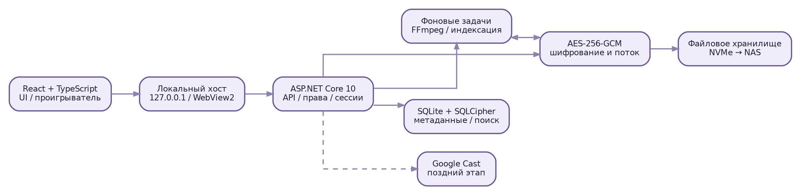
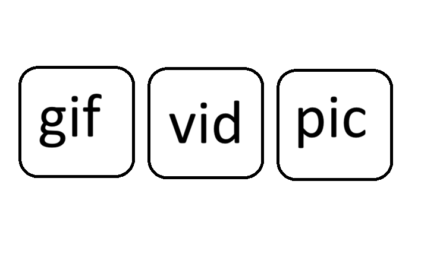
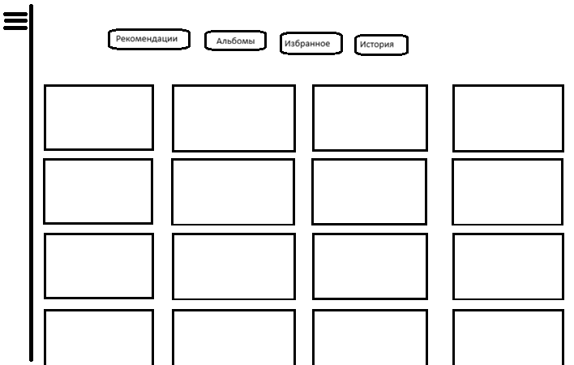
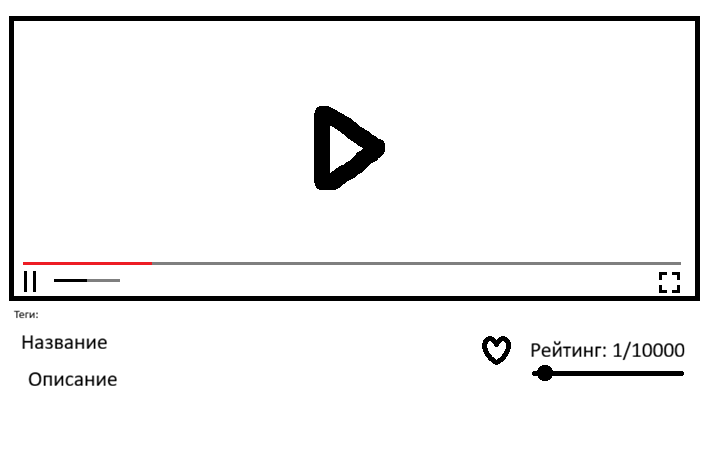

# Содержание

| № | Раздел |
|---:|---|
| — | Паспорт документа |
| 1 | Реестр требований и приоритетов |
| 2 | Пользователи, роли и общие правила |
| 3 | Архитектура программного решения |
| 4 | Схема установки и расположение данных |
| 5 | Шифрование, ключи и приватность |
| 6 | Каталог данных и модель БД |
| 7 | Категории, теги, альбомы, избранное |
| 8 | Импорт одного медиафайла |
| 9 | Поиск, фильтрация и сортировка |
| 10 | Рекомендации и история |
| 11 | Проигрыватель видео |
| 12 | Фото, GIF и превью |
| 13 | Дизайн и карта экранов |
| 14 | Настройки и их схема |
| 15 | Горячие клавиши |
| 16 | AFK-блокировка и сохранение контекста |
| 17 | Google Cast и Android TV |
| 18 | Состояния, ошибки и уведомления |
| 19 | Контракт API и интеграции |
| 20 | Нефункциональные требования |
| 21 | Резервное копирование, восстановление, обновление |
| 22 | Стандарты проектирования и разработки |
| 23 | Тестирование и критерии приёмки |
| 24 | Пошаговый план разработки и точки приёмки |
| 25 | Риски и принятые ограничения |
| 26 | Остаточные вопросы для финального утверждения |
| 27 | Чек-лист готовности спецификации |
| — | Приложение А. Нормативные и технические источники |
| — | Приложение Б. Тестовые данные и нейтральный контент |
| — | Приложение В. История решений (ADR-заготовки) |

# Паспорт документа

| Поле | Значение |
|---|---|
| Проект | **Shronchik** |
| Версия документа | **1.1 — согласованные уточнения от 04.11.2026** |
| Дата | 04.11.2026 |
| Платформа первого релиза | Windows 11, один домашний ПК |
| Назначение | Частная медиатека контента для взрослых: фото, видео, GIF |
| Языки интерфейса | Русский, английский |
| Масштаб хранения | Сейчас около 20 ГБ; целевой ориентир — до 20 ТБ и выше |
| Роли | Admin и User, общая медиатека |
| Хранение | Сначала локальный NVMe; далее перенос на NAS/RAID |
| Режим работы | Локально, без обязательного Интернета; возможность будущего веб-хостинга |
| Статус | Требования собраны, реализация ещё не начата |

**Как читать документ.** Маркер **[СОГЛАСОВАНО]** означает прямое требование владельца проекта; **[ПРОЕКТНОЕ РЕШЕНИЕ]** — техническое предложение, которое обеспечивает требование, но может быть изменено; **[УТОЧНИТЬ]** — неоднозначность, которую нельзя выдавать за окончательное решение; **[ПОЗЖЕ]** — функция после базового релиза. Значения по умолчанию, не заданные владельцем, явно называются предварительными.

**Предупреждение.** Документ описывает целевую систему, а не уже созданную программу. Числа производительности — критерии для проверки, а не измеренные результаты. Стандарты и зависимости проверены по источникам в приложении А.

## 0.1. Цель и принципы

Shronchik — устанавливаемая на Windows 11 персональная медиатека для законно хранимого контента 18+. Пользователь видит три корневых раздела GIF / Видео / Фото, переключается между вкладками (Видео: Рекомендации; Фото/GIF: Главная; далее Альбомы, Избранное, История), фильтрует файлы по тегам и смотрит их без прямого доступа к исходным файлам в папке. Основные принципы:

1. **Локальная приватность:** интернет не обязателен; автоматической передачи файлов и метаданных наружу нет.
2. **Защищённое хранение:** все оригиналы, обложки, миниатюры и сохранённые превью зашифрованы.
3. **Скорость:** работа интерфейса должна зависеть от размера видимой области и индексов, а не от числа файлов в библиотеке.
4. **Контроль пользователя:** большое число настраиваемых параметров и сброс к значениям по умолчанию.
5. **Переносимость:** программу можно переустановить на C:, не теряя медиатеку на другом носителе.
6. **Расширяемость:** веб-frontend должен позволить позже добавить браузерный серверный режим, NAS и интернет-функции без переписывания интерфейса.

## 0.2. Что входит и не входит

**Входит:** два локальных аккаунта; пароль и AFK-блокировка; импорт по одному файлу; теги и вложенные подкатегории; альбомы, избранное, история; рейтинг 1–10000; поиск с трёхпозиционными тегами; потоковая расшифровка; проигрыватель; анимированные превью; рекомендации; настройка тем, сетки и хоткеев; перенос данных; корзина (по умолчанию 30 дней, срок задаёт Admin); обновления; учёт просмотров только для User; подготовка к Cast.

**Не входит в первую стабильную версию:** облачная синхронизация, многопользовательский доступ по сети, мобильное приложение, автоматический парсинг сайтов, создание нескольких окон воспроизведения, массовый импорт каталогов, сохранение наборов фильтров, журнал действий администратора, отдельная панель информации справа.

# 1. Реестр требований и приоритетов

| ID | Требование | Приоритет | Статус |
|---|---|---|---|
| FR-001 | Три стартовые категории: GIF, Видео, Фото; дополнительные и вложенные категории | P0 | СОГЛАСОВАНО |
| FR-002 | Две фиксированные роли Admin/User, общая библиотека | P0 | СОГЛАСОВАНО |
| FR-003 | Стартовые пароли 1111, смена обоих администратором | P0 | СОГЛАСОВАНО, риск |
| FR-004 | Все исходные медиа, постеры, миниатюры, анимированные превью шифруются | P0 | СОГЛАСОВАНО |
| FR-005 | Импорт строго одного файла за одну операцию, с копированием в хранилище | P0 | СОГЛАСОВАНО |
| FR-006 | Дедупликация по содержимому | P0 | СОГЛАСОВАНО |
| FR-007 | Теги include/exclude/neutral в скрываемой левой панели | P0 | СОГЛАСОВАНО |
| FR-008 | Рейтинг 1–10000, ползунок и число, фотографии/GIF/видео | P0 | СОГЛАСОВАНО |
| FR-009 | Видео: Рекомендации/Альбомы/Избранное/История; Фото и GIF: Главная/Альбомы/Избранное/История; «Главная» случайно перемешивается | P0 | СОГЛАСОВАНО |
| FR-010 | Рекомендации видео: 70% по рейтингу, 30% случайно, вкладка обновляется повторным нажатием | P0 | СОГЛАСОВАНО |
| FR-011 | Рекомендации учитывают теги последних 30 просмотренных видео User | P1 | СОГЛАСОВАНО |
| FR-012 | Видеоплеер с обложкой в размытии, запуском вручную, перемоткой и громкостью | P0 | СОГЛАСОВАНО |
| FR-013 | Превью видео без звука при наведении, GIF в видимой области автоматически | P0 | СОГЛАСОВАНО |
| FR-014 | Плеер: 3 похожих и 2 случайных снизу; состав и число настраиваются | P1 | СОГЛАСОВАНО |
| FR-015 | Корзина по умолчанию 30 дней, срок настраивает Admin; восстановление всех связей и метаданных | P0 | СОГЛАСОВАНО |
| FR-016 | Смена директории, перенос на другие диски/NAS и восстановление связи с хранилищем | P0 | СОГЛАСОВАНО |
| FR-017 | Общие настройки и переназначаемые клавиши; тема и скорость анимаций | P0 | СОГЛАСОВАНО |
| FR-018 | Windows 11, установщик, RU/EN, локальный режим; публикация GitHub отложена | P0 | СОГЛАСОВАНО |
| FR-019 | Android TV / Google Cast из плеера | P2 | ОТЛОЖЕНО, НЕ В БЛИЖАЙШЕМ ПЛАНЕ |
| FR-020 | Не учитывать Admin в просмотрах и рекомендационной истории | P0 | СОГЛАСОВАНО |
| FR-021 | Один recovery-файл/ключ библиотеки без дополнительного пароля для сброса Admin | P1 | СОГЛАСОВАНО, требуется защитная реализация |
| FR-022 | Поддержка до 8K там, где разрешают кодек/устройство | P1 | СОГЛАСОВАНО как цель |
| FR-023 | Многочисленные ненавязчивые анимации, адаптивность 21:9 | P1 | СОГЛАСОВАНО |

**Приоритеты:** P0 — без этого релиз нельзя принимать; P1 — важная функция целевого полноценного релиза; P2 — расширение после устойчивого ядра. Ни одно P2 не должно блокировать выпуск P0.

# 2. Пользователи, роли и общие правила

## 2.1. Модель ролей

Аккаунтов строго два: `Admin` и `User`. У каждого свой логин и пароль, администратор может менять оба пароля. Данные медиатеки и предпочтения, относящиеся к файлам, общие. Вход определяет права, но не создаёт отдельную библиотеку.

| Операция | Admin | User |
|---|---|---|
| Смотреть фото/GIF/видео, искать, фильтровать | Да | Да |
| Просматривать общие рейтинги, избранное, альбомы, теги | Да | Да |
| Загружать/удалять/восстанавливать файлы | Да | Нет |
| Переименовывать, редактировать описания, теги, обложки, категории | Да | Нет |
| Выставлять/менять рейтинг от 1 до 10000 и избранное | Да | Да |
| Изменять состав альбомов (добавлять/удалять медиа) | Да | Нет |
| Редактировать настройки интерфейса, AFK и горячие клавиши | Да | Да |
| Менять пароль любого аккаунта, путь хранения и ключи | Да | Нет |
| Экспортировать оригинал или получать исходный файл | Только отдельным административным действием | Нет |
| Влиять на счётчик просмотров при первом фактическом запуске | Нет | Да |
| Попадать в историю рекомендаций по просмотренным видео | Нет | Да |

**[СОГЛАСОВАНО]** User вправе менять общие оценки (1–10000) и добавлять/убирать файлы из избранного. Эти два действия являются исключением из общего режима «только просмотр». User не получает прав на изменение названий, описаний, тегов, обложек, категорий, альбомов, импорт, корзину или экспорт; ограничения должны действовать на уровне API, а не только кнопок.

## 2.2. Что означает «одна история»

История раздела для фото/GIF/видео — общий список последних десяти открытых объектов соответствующего вида (ограничение 10). Для рекомендаций существует отдельное служебное окно последних **30 запущенных видео User**, которое не нужно показывать как обычную историю. Просмотр Admin не добавляет статистическую запись User. Детальное поведение истории фото/GIF — проектное решение: фиксировать открытие большого просмотрщика, а не простое появление миниатюры в сетке.

## 2.3. Учёт просмотра

Событие `ViewStarted` создаётся **однократно за одно открытие видео** при первом нажатии на Play в роли User. Открытие страницы с постером, автоподготовка потока, перемотка в режиме паузы и повторное Resume в рамках того же открытого плеера не увеличивают счётчик. Возврат в видео через новую карточку создаёт новую сессию просмотра и допускает новый счёт. Admin не создаёт это событие. Просмотры фото и GIF для рекомендательной модели не используются.

## 2.4. Начальные пароли и риски

[СОГЛАСОВАНО] В первом запуске действуют логины `Admin`, `User` и пароли `1111` для обоих аккаунтов. Такие пароли **не являются надёжной защитой** от человека, получившего доступ к компьютеру или копию базы: их легко угадать даже при использовании правильного алгоритма хранения. Реализация должна показывать явное предупреждение до первого импорта и напоминать сменить пароль Admin. Без изменения слабого пароля обещать стойкую защиту содержимого нельзя.

Требование «User только просмотр» применяется также на сервере: недостаточно скрыть кнопки. Прямая попытка вызвать административный API должна возвращать `403 Forbidden`.

# 3. Архитектура программного решения

## 3.1. Рекомендуемый технологический стек

| Слой | Выбор | Причина / ограничение |
|---|---|---|
| Интерфейс | React + TypeScript + Vite | Современный адаптивный интерфейс, повторное использование в будущей веб-версии |
| Десктоп-оболочка | Локальный хост + WebView2 | Окно Windows без обязательного браузера, веб-технологии внутри |
| Сервер | C# / ASP.NET Core на .NET 10 LTS | Потоковые ответы, фоновая обработка, права доступа, Windows |
| Локальная БД | SQLite; SQLCipher как вариант шифрования БД | Индексы, FTS, транзакции; проверить сборку и лицензию |
| Обработка медиа | FFmpeg/ffprobe как внешние компоненты | Определение метаданных, миниатюры, преобразование и превью |
| Потоковое шифрование | AES-256-GCM по независимым блокам | Можно дешифровать произвольную часть большого видео |
| Поиск | Индексы + SQLite FTS5 в зашифрованной базе | Быстрый поиск по названиям, тегам, описаниям |
| Очереди | Локальная устойчивая очередь jobs в БД | Перезапуск обработки после сбоя |
| Распространение | Локальный установщик Windows; GitHub позднее | Релизы без пользовательских медиа в репозитории |

[ПРОЕКТНОЕ РЕШЕНИЕ] Для первого выпуска интерфейс открыт в отдельном окне WebView2, а сервер слушает только локальный интерфейс `127.0.0.1` с динамическим портом. Для отладки разрешён системный браузер. WebView2 сам по себе не означает, что приложение доступно по сети.

Позднее при желании хостить сайт можно перенести сервер в серверную среду, использовать HTTPS и отдельную систему управления доступом. Это **новый режим развёртывания**, не просто изменение адреса `127.0.0.1` на `0.0.0.0`.



## 3.2. Разделение модулей

- `UI` — маршруты, карточки, страницы, модальные окна, анимации, языки, настройки, виртуальная сетка.
- `Auth` — два аккаунта, Argon2id, сессии, AFK, повторная аутентификация, файл восстановления.
- `Library` — категории, теги, альбомы, рейтинг, избранное, история, корзина.
- `Catalog` — импорт, дедупликация, метаданные, индексация, поиск, сортировки.
- `Media` — постеры, GIF-превью, видео и потоковая выдача с перемоткой.
- `Crypto` — ключи, шифрование блоков, контроль целостности, миграция ключей.
- `Recommendations` — случайная и рейтинговая выборки, частотность тегов.
- `Storage` — локальные тома, NAS-путь, перенос, атомарные операции, резервирование.
- `Settings` — проверка диапазонов, общие значения, цветовая схема, горячие клавиши.
- `Cast` — отдельный необязательный модуль; отключён до проверки на телевизоре.

Запрещено делать прямой доступ UI к файлам диска, ключам или SQLite. UI работает только через авторизованный API.

## 3.3. Запуск и остановка

1. Пользователь нажимает ярлык `Shronchik`.
2. Launcher проверяет наличие настроенного каталога, доступность диска, целостность конфигурации и состояние единственного экземпляра.
3. Сервис запускает локальный сервер, открывает БД, проверяет схему и запускает очередь незавершённых задач.
4. Открывается окно WebView2 со страницей выбора/ввода логина и пароля.
5. После авторизации отображается главная с тремя категориями.
6. При закрытии UI сервер останавливает новые задания, завершает транзакции, очищает временные ключи и выпускает lock-файл.

Обработка видеопревью может завершаться асинхронно, но потеря электропитания не должна оставлять «готовый» объект без полностью записанного зашифрованного оригинала.

## 3.4. Локальная безопасность API

- Привязка только к loopback, контроль `Host`, `Origin`, CSRF для изменяющих запросов.
- Сессионная cookie `HttpOnly`, `SameSite=Strict`, `Secure` при HTTPS; при локальном HTTP применять локальную схему с той же защитой от сторонних origin; не хранить токен в `localStorage`.
- Права проверяются на каждой операции. Никаких путей произвольных файлов от клиента.
- Изображения и видео выдаются лишь по непрогнозируемому идентификатору медиа и авторизованному запросу; отсутствует публичная папка оригиналов.
- Не разрешать CORS `*` для приватных ресурсов. Чёткая политика localhost/кастинга.
- Блокировка сессии должна реально перекрывать API медиаконтента, а не только показывать экран поверх видео.

# 4. Схема установки и расположение данных

## 4.1. Логика директорий

Приложение и данные хранятся независимо. Пример (пути не обязательные):

```text
C:\Program Files\Shronchik\
  Shronchik.exe
  server\
  web\
  ffmpeg\

D:\ShronchikLibrary\
  library.json            # версия/ID тома, без секретов
  vault\ab\cd\<opaque-id>.srm  # шифрованные оригиналы
  thumbs\...             # шифрованные обложки
  previews\...           # шифрованные анимированные превью
  db\catalog.sqlite      # БД: локально; защитить SQLCipher
  trash\...              # шифрованные файлы в корзине
  recovery-metadata\...  # служебные версии / незавершённые операции
```

**Важно:** имена оригинальных файлов (`video_name.mp4`) в файловых путях не оставлять: хранить нейтральные идентификаторы. Оригинальное имя — метаданные в защищённой БД. Файл восстановления ключей **не хранить рядом с медиатекой**.

## 4.2. Переустановка Windows

После переустановки Windows пользователь устанавливает Shronchik на C:, выбирает «Подключить существующую библиотеку», указывает `D:\ShronchikLibrary` и проходит проверку ключей и версии схемы. Система восстанавливает категории, теги, альбомы, рейтинг, настройки и корзину, если они сохранены вместе с защищёнными данными и ключ восстановления имеется. Нельзя полагаться только на Windows DPAPI без переносимого пути восстановления: после переустановки Windows эти секреты могут стать недоступны.

## 4.3. NAS / RAID

[СОГЛАСОВАНО] Пользователь планирует перенести библиотеку на NAS, вероятно с RAID. RAID повышает устойчивость к отказу отдельных дисков при правильной конфигурации, **но не защищает** от удаления, вируса, шифровальщика, ошибки приложения, повреждения БД или потери ключа. Резервная копия нужна отдельно.

[ПРОЕКТНОЕ РЕШЕНИЕ] На NAS размещать зашифрованные `vault`, `thumbs`, `previews`, `trash`, а активную БД SQLite с WAL оставлять на локальном SSD (с регулярными консистентными зашифрованными резервными копиями на NAS). Документация SQLite прямо указывает, что WAL не работает поверх сетевой файловой системы между разными машинами. Если в будущем нужен **именно удалённый каталог БД**, надёжный путь — перенести сервер и БД на одну машину NAS/сервер, а не открывать SQLite через SMB с другого ПК.

## 4.4. Алгоритм смены диска/директории

1. Проверить свободное место, доступ, права на запись и версию формата.
2. Приостановить импорт и фоновое построение превью.
3. Создать журнал миграции с перечнем файлов, размером и контрольными суммами шифротекста.
4. Копировать, не удаляя исходное; возобновлять после обрыва.
5. Проверить контрольные суммы, количество объектов и доступность выбранных образцов.
6. Атомарно изменить запись активного тома после полной проверки.
7. Предложить удалить старую копию **только после явного подтверждения** и при наличии резервной копии.

Простое изменение буквы диска должно решаться через выбор каталога и сопоставление стабильного UUID библиотеки; полные пути не должны быть разбросаны по тысячам строк БД.

# 5. Шифрование, ключи и приватность

## 5.1. Модель угроз

Защищаемся от: простого открытия файлов в проводнике; копирования каталога на другой компьютер; просмотра без входа в Shronchik; чтения миниатюр из кэша; случайного доступа к данным роли User через UI. **Не обещаем** защиту от администратора Windows с отладчиком, вредоносного ПО на разблокированном ПК, записи экрана, съёмки телевизора, извлечения потока во время разрешённого просмотра или получения файла восстановления вместе с библиотекой.

## 5.2. Схема ключей

1. При создании новой библиотеки генерируется случайный 256-битный мастер-ключ данных `K_master`.
2. Для каждого файла генерируется уникальный `file_id` и независимый ключ или под-ключ, выведенный через HKDF с контекстом `file_id`/версией. Реализация должна формально исключать повтор ключа и nonce.
3. Оригиналы и производные файлы шифруются AES-256-GCM блоками. У каждого блока — уникальный nonce и тег аутентичности.
4. Для сохранения мастер-ключ шифруется ключом упаковки `KEK`, полученным через Argon2id из пароля, с солью и параметрами в заголовке.
5. Пароли хранятся только в виде медленных salted-хешей; ключ доступа к библиотеке и хеш для входа — разные сущности.
6. Для второго аккаунта мастер-ключ можно упаковать вторым, независимо созданным ключом доступа, если User должен уметь просматривать библиотеку с собственным паролем.
7. При смене пароля перешифровывается **обёртка ключа**, а не все 20 ТБ медиа. При компрометации мастер-ключа требуется уже полная переупаковка/ротация ключевого материала по утверждённой процедуре.

Начальный пароль `1111` означает низкую защиту парольной обёртки от перебора. Никакая AES-256 не исправляет слабость секретного пароля. Для безопасного использования нужно менять пароли на стойкие; при стандартных паролях система должна показывать предупреждение.

## 5.3. Потоковое шифрование больших файлов

**Не использовать один огромный AES-GCM-контейнер** для целого видео, если нужна быстрая произвольная перемотка. Предлагаемый внутренний формат `SRM1`:

| Поле | Назначение |
|---|---|
| `magic`, `format_version` | Проверка формата и миграция |
| `file_id`, `key_version` | Связь с защищённой БД и поколением ключа |
| `content_length`, `chunk_size`, `chunk_count` | Вычисление диапазона данных |
| `header_nonce`, `header_tag` | Аутентификация заголовка |
| Записи блоков | Зашифрованные данные, nonce, тег GCM |
| Защищённый индекс | Отображение номера блока на смещение в контейнере |

Ориентир размера блока: **1–4 МиБ, подбирается экспериментально**. GCM никогда не должен повторно использовать пару `(ключ, nonce)`; связанные с блоком `file_id`, индекс, версия и размер входят в AAD. Любая ошибка тега — отказ выдавать блок и сообщение о повреждении. Данные расшифровываются только в оперативную память и отдаются в авторизованный поток. Не создавать временные MP4/JPEG/GIF в общей папке `%TEMP%`.

Для запроса `Range: bytes=start-end` сервер вычисляет затронутые блоки, читает их, проверяет теги и возвращает ровно требуемый диапазон. Для браузерной перемотки поддерживать `206 Partial Content`, `Content-Range`, `Accept-Ranges` и `416` при неверном диапазоне.

## 5.4. Миниатюры, превью, память

- Постеры, изображения карточек, анимированные превью и GIF-кэш хранятся **только шифрованно**.
- В RAM допускается LRU-кэш расшифрованных изображений с верхним лимитом и очисткой при блокировке/выходе. Операционная система всё же может создавать swap или дампы: стопроцентной невозможности извлечь изображение из памяти нет.
- Браузерные дисковые HTTP-кэши запрещать заголовком `Cache-Control: no-store`; `blob:` URL отзывать после использования; не передавать объекты в service worker/offline cache.
- Для GIF желательно производить оптимизированные короткие видеопревью для карточек (при сохранении исходного GIF), если браузер поддерживает подходящий кодек. Плеер оригинала при открытии использует исходные кадры.
- Предзагружать только ближайший экран, прекращать декодирование вне видимости, ограничивать число одновременных анимаций.

## 5.5. Файл восстановления Admin

[СОГЛАСОВАНО] В панели Admin можно получить файл, запуск которого сбрасывает пароль Admin на `1111`. **Нельзя** реализовать универсальный «сброс пароля» без доступа к ключам: новый пароль сам по себе не сможет расшифровать старый `K_master`.

[ПРОЕКТНОЕ РЕШЕНИЕ] При создании библиотеки выпускается уникальный подписанный/аутентифицированный для этой библиотеки **пакет восстановления**, который хранит случайный recovery-secret или защищённую обёртку ключа. Отдельная утилита на ПК проверяет принадлежность пакета к этой библиотеке и сбрасывает пароль Admin на стандартный `1111`, сохраняя возможность расшифрования библиотеки. **[СОГЛАСОВАНО]** Нужен ровно один уникальный recovery-файл/ключ без дополнительной passphrase. Владение этим файлом само по себе считается достаточным подтверждением для восстановления; это повышает ущерб при краже ключа. User-пароль и файлы остаются прежними. После применения пакет по возможности ротируется/отзывается. Пакет следует держать офлайн, **не в каталоге NAS/медиатеки и не на GitHub**. Кто владеет им, тот потенциально может получить контроль над всей библиотекой. Отдельно проверить сценарий переустановки Windows.

## 5.6. Обработка инцидентов

- Ошибка тега GCM: запретить просмотр повреждённого объекта, не выдавать частичные неподтверждённые данные.
- Подозрительная смена файлов на диске: повторная сверка контрольных сумм.
- Утрата recovery-файла при забытом обоих паролях: честно сообщать, что без ключей шифрование может быть невосстановимым.
- Неправильный пароль: постепенная задержка попыток, никаких подсказок о доступности мастер-ключа.
- Режим блокировки: останавливать поток и очищать доступные RAM-кэши, но сохранять маршрут, scroll, timeline и UI-state без секретов.

# 6. Каталог данных и модель БД

## 6.1. Основные сущности

| Таблица | Ключевые поля | Назначение и ограничения |
|---|---|---|
| `media` | `id`, `media_type`, `category_id`, `name`, `description`, `rating`, `duration_ms`, `width`, `height`, `size`, `hash`, `created_at`, `imported_at`, `deleted_at`, `status` | Одна логическая карточка; `rating` от 1 до 10000 или NULL до назначения |
| `media_files` | `media_id`, `vault_object_id`, `key_version`, `mime`, `container`, `codec`, `size_bytes` | Физический защищённый оригинал |
| `categories` | `id`, `parent_id`, `root_type`, `name`, `sort_order` | Подкатегории произвольной вложенности; отсутствие циклов |
| `tags` | `id`, `name`, `normalized_name`, `parent_id` (необязательно) | Глобальный словарь тегов; уникальность нормализованного имени |
| `media_tags` | `media_id`, `tag_id` | Множественная связь, составной уникальный ключ |
| `albums` | `id`, `root_type`, `name`, `description`, `created_at` | Альбомы внутри раздела; обложка последнего добавленного |
| `album_items` | `album_id`, `media_id`, `added_at`, `sort_order` | Принадлежность к нескольким альбомам |
| `favorites` | `media_id`, `added_at` | Один общий для обеих ролей набор |
| `play_sessions` | `id`, `media_id`, `role`, `opened_at`, `first_play_at`, `view_counted` | Защита от двойного учёта |
| `view_events` | `id`, `media_id`, `occurred_at` | События запуска User, статистика и модель последних 30 |
| `recent_opened` | `root_type`, `media_id`, `opened_at` | История UI: максимум 10 на раздел |
| `covers` | `media_id`, `kind`, `vault_object_id`, `source_time_ms` | Защищённые постеры / альтернативные кадры |
| `imports` | `id`, `source_fingerprint`, `phase`, `progress`, `error`, `created_at` | Возобновление обработки после сбоя |
| `trash_items` | `media_id`, `deleted_at`, `purge_after`, `snapshot_version` | Логическое удаление и индивидуальный срок; по умолчанию 30 дней |
| `library_volumes` | `id`, `location`, `is_active`, `last_seen`, `storage_type` | Перенос и сопоставление томов |
| `app_settings` | `key`, `value_json`, `updated_at`, `schema_version` | Общие настройки с валидацией |
| `keybindings` | `action`, `shortcut`, `scope` | Настраиваемые горячие клавиши |
| `jobs` | `id`, `kind`, `media_id`, `state`, `attempts`, `priority`, `lease_until` | Фоновая очередь |
| `schema_migrations` | `version`, `applied_at`, `checksum` | Безопасные обновления базы |

Статистика просмотров не должна храниться только числом на карточке: счётчик можно обновлять атомарно, а события нужны для рекомендаций и диагностики. На 20 ТБ не хранить сами видео в BLOB-полях SQLite; БД хранит только индексы и ссылки на шифрованные объекты.

## 6.2. Ограничения и индексы

- `media.id` — UUID/ULID, не зависит от физического пути; UUID рекомендуется для переносимости между библиотеками.
- `rating BETWEEN 1 AND 10000`, `media_type IN ('video','photo','gif')`, `size_bytes >= 0`.
- Индексы `media(type, status, imported_at DESC, id)` и `media(type, rating DESC, id)`.
- Индексы для `media_tags(tag_id, media_id)`, `album_items(album_id, sort_order)`, `view_events(occurred_at DESC)`.
- Поиск по `name`, `description` через FTS5; нормализацию языка/регистра и токенизацию проверить на RU/EN.
- Не позволять удалять корневые категории и создавать вложенную категорию, ведущую к циклу.
- Каскадное физическое удаление связей — только при окончательном очищении корзины, а не при мягком удалении.
- Каждая миграция БД имеет номер, проверку целостности и план отката из резервной копии.

## 6.3. Пример SQL-ограничений (упрощённый)

```sql
CREATE TABLE media (
  id TEXT PRIMARY KEY,
  media_type TEXT NOT NULL CHECK(media_type IN ('video','photo','gif')),
  name TEXT NOT NULL DEFAULT '',
  description TEXT NOT NULL DEFAULT '',
  rating INTEGER CHECK(rating BETWEEN 1 AND 10000),
  duration_ms INTEGER,
  width INTEGER,
  height INTEGER,
  imported_at TEXT NOT NULL,
  deleted_at TEXT,
  status TEXT NOT NULL DEFAULT 'ready'
);
CREATE INDEX ix_media_type_date ON media(media_type, status, imported_at DESC, id);
CREATE INDEX ix_media_type_rating ON media(media_type, status, rating DESC, id);
```

Этот код иллюстрирует ограничения, а не представляет готовую окончательную миграцию: в рабочей схеме будут дополнительные внешние ключи, индексы и таблицы.

## 6.4. Транзакционность и журнал операций

При изменении названия, тегов, рейтинга и альбомов всё сохраняется одной БД-транзакцией. Импорт оригинала — двухфазная операция между БД и файловой системой: сначала запись временного объекта и подтверждение шифрования, затем атомарное переименование и фиксация `ready` в БД. После аварии reconciliation-процедура выявляет `staging` без записи и записи без файла и переводит их в безопасный режим восстановления.

# 7. Категории, теги, альбомы, избранное

## 7.1. Корневые разделы

На главной показаны три большие плитки: `GIF`, `Видео`, `Фото`. Их положение соответствует рисунку владельца; иконографика, типографика, радиусы, фон и анимации ещё могут быть изменены. Каждая плитка ведёт в отдельную категорию. Внутри доступны вкладки `Рекомендации`, `Альбомы`, `Избранное`, `История` для Видео; `Главная`, `Альбомы`, `Избранное`, `История` для Фото и GIF (см. 7.2).

## 7.2. Разделы «Рекомендации» вне видео

**[СОГЛАСОВАНО]** Для разделов **Фото** и **GIF** первая вкладка называется **«Главная»**, а не «Рекомендации». На ней показываются доступные файлы в случайном порядке без модели предпочтений, истории просмотров и весов рейтинга. При входе создаётся новая случайная последовательность, бесконечная подгрузка использует стабильный seed без повторов. Повторное нажатие на «Главная» пересоздаёт случайную выборку (предложенное единообразное поведение). Остальные вкладки: «Альбомы», «Избранное», «История». Для **Видео** первая вкладка по-прежнему «Рекомендации» с алгоритмом 70/30 и последними 30 просмотрами.

## 7.3. Подкатегории

Корневая категория фиксирует тип контента. Подкатегория может иметь родителя внутри того же корня; файл прикрепляется к одной выбранной подкатегории (и логически входит в родителей). Перенос видео в раздел «Фото» не допускается без явного переопределения типа; категория — не подмена файлового формата. Перемещение в другую подкатегорию не требует физического копирования оригинала.

## 7.4. Теги

Количество тегов у медиа практически не ограничивается, но интерфейс должен выдерживать тысячи названий. Имя уникально после trim, Unicode-нормализации и case-insensitive сравнения; отображаемый регистр можно сохранить. Операции Admin: создать, переименовать, объединить с другим тегом, присвоить/снять у одного или многих файлов. Удаление тега не удаляет медиа. Клик по тегу в карточке видео: закрыть текущий просмотр, открыть вкладку рекомендаций категории Видео, очистить **все** предыдущие фильтры и активировать выбранный тег в режиме «включить».

## 7.5. Альбомы

Альбом может содержать много файлов и один файл может быть в нескольких альбомах. Обложка альбома автоматически берётся из главной обложки **последнего добавленного в этот альбом файла**. Если обложка недоступна, используется нейтральный placeholder. Карточка альбома показывает название и число доступных элементов, а при переходе — бесконечную галерею. Удаление альбома не удаляет содержимые медиа.

## 7.6. Избранное и рейтинг

Избранное — единый логический флаг для библиотеки; значок сердечка присутствует у видео. Рейтинг имеет диапазон **1–10000** и может быть `не выставлен` (NULL). По умолчанию рейтинг не приравнивать к 1, чтобы не путать отсутствие оценки с очень низкой оценкой. Редактирование доступно Admin при импорте; Admin и User могут менять рейтинг прямо при просмотре: числовое поле с ручным вводом и ползунок синхронизированы. Сохранение — с небольшой debounce-задержкой и подтверждением, при ошибке значение откатывается с уведомлением.

## 7.7. Массовое редактирование

Admin может выделить несколько **уже загруженных** файлов и одной операцией добавить/удалить теги, переместить в подкатегорию, добавить в альбом или в избранное. Это не нарушает требование «загрузка строго одного файла»: массовое редактирование применяется только к существующей библиотеке. Операции с несколькими файлами показывают предварительный список затронутых объектов, успех/ошибки и возможность отмены до подтверждения.

# 8. Импорт одного медиафайла

## 8.1. Последовательность загрузки


1. Admin выбирает **ровно один** файл через системный диалог или Drag & Drop одного файла.
2. Интерфейс отображает имя, размер, тип и предупреждение, если путь расположен на недоступном диске.
3. Сервер определяет содержимое по сигнатуре и `ffprobe`, а не доверяет расширению.
4. Вычисляется SHA-256 содержимого потоково; проверяется дубликат по хешу и размеру.
5. Если дубликат найден, программа предлагает открыть существующий, отменить импорт или связать файл с новой подкатегорией/альбомом **без второго экземпляра оригинала**. Физический дубликат не создаётся автоматически.
6. Admin вводит необязательные название, описание, теги, подкатегорию, альбомы и рейтинг.
7. Для видео генерируется несколько кандидатов обложки из разных временных точек, исключая очевидно пустые/чёрные кадры, когда это возможно; можно загрузить собственную обложку. При отсутствии выбора ставится предложенный кадр.
8. Создаются требуемые миниатюры, анимированные превью, техметаданные. Процесс показывает прогресс.
9. Оригинал и производные данные шифруются в `staging` на целевом томе, проверяются, публикуются атомарно.
10. В БД фиксируется готовая карточка, индекс поиска обновляется, пользователю показывается результат.

**Обязательные поля:** сам файл и определённый тип. Название может по умолчанию копироваться из исходного имени; описание и теги необязательны. Рейтинг необязателен. Редактирование во время и после импорта доступно Admin.

## 8.2. Обложки

Для ролика предложить, например, **5 кадров** на 10%, 25%, 45%, 65%, 85% длительности (это предложенный алгоритм, не фиксированное требование). Убрать резкие чёрные кадры по упрощённой проверке яркости. Кандидаты не должны сохраняться открытыми JPEG в пользовательской `%TEMP%`; использовать RAM или шифрованный рабочий контейнер. Кнопка «Перегенерировать кадры» повторно создаёт варианты. Отдельно загруженное изображение проходит валидацию и шифрование, как любой постер.

## 8.3. Поддерживаемые форматы

- Фото: JPEG/JPG, PNG, WebP, BMP, TIFF, AVIF, HEIC — фактическая поддержка зависит от доступных декодеров.
- GIF: GIF, включая многофреймовые; анимированный WebP — после проверки декодера.
- Видео: MP4, MKV, WebM, MOV, AVI, M4V; H.264, H.265/HEVC, VP9, AV1 и другие популярные кодеки через поддерживаемый pipeline.

**«Все популярные» ≠ гарантировать воспроизведение каждого файла.** Импорт может быть возможен, а воспроизведение в браузере — нет. При несовместимости требуется на-лету транскодирование FFmpeg или показ понятной ошибки, без тихого изменения исходного файла.

## 8.4. Отказоустойчивость импорта

- Недостаточно места — не начинать финальное шифрование, показать оценку необходимого места.
- Приложение закрыто — после запуска продолжить безопасный этап/убрать staging; не дублировать объект.
- Исходный файл удалён во время импорта — отказ без публикации неполного объекта.
- Сбой генерации превью — оригинал можно пометить как `ready_with_pending_preview`, запланировать повтор.
- Неправильный контейнер или повреждённый поток — сохранить понятную диагностику без логирования содержимого файла.
- Огромный файл — читать и шифровать потоково, не загружая 100+ ГБ в память.

# 9. Поиск, фильтрация и сортировка

## 9.1. Трёхпозиционные теги

Левая скрываемая панель содержит поле поиска по названию/описанию/тегам и список тегов. Каждый тег имеет три состояния: `Нейтрально` (не влияет), `Включить` (обязателен), `Исключить` (запрещён). В UI состояния различаются и цветом, и значком, чтобы не зависеть только от цвета.

Правило по умолчанию для нескольких «включить» — **AND**: каждый выбранный тег должен присутствовать у файла. «Исключить» — **NOT**: ни один запрещённый тег не должен присутствовать. Условия поиска по строке и категории объединяются через AND. Если пользователь позже захочет OR, это отдельная настраиваемая опция, не менять семантику молча.

**Пример:** `+Аниме +Арт -Мемы` означает медиа с двумя первыми тегами и без третьего. Нажатие по тегу из плеера полностью сбрасывает строку поиска, ранее включённые/исключённые теги и временные фильтры, затем ставит один новый `+тег`.

## 9.2. Поисковое окно и панель

- Боковая панель выдвигается поверх/сжимает контент с плавной анимацией; её состояние сохраняется между страницами.
- Поле поиска поддерживает кириллицу/латиницу, пробелы, регистр не важен; debounce ориентировочно 150–250 мс.
- Изменения не должны блокировать поток рендера; отменять устаревшие запросы при новом вводе.
- Фильтры не сохраняются как именованные пресеты (явно не требуется).
- Сверху панели — название корневого раздела; **внизу кнопка Назад** на страницу трёх главных категорий.
- В ходе прокрутки заголовок с вкладками остаётся закреплённым.

## 9.3. Сортировки

[СОГЛАСОВАНО] `Сначала новые`, `Сначала старые`, `По длительности`, `По рейтингу ↑`, `По рейтингу ↓`. Для длительности — отдельные `короткие→длинные` и `длинные→короткие` как проектное уточнение; для фото/GIF при отсутствии длительности не показывать неприменимые способы. `NULL`-рейтинг всегда в конце, независимо от направления. При одинаковых ключах обязательная стабильная сортировка по `id`, чтобы бесконечная лента не дублировала и не пропускала карточки.

## 9.4. Бесконечная сетка

Использовать **курсорную пагинацию**, а не OFFSET на миллионах строк; UI виртуализирует карточки и хранит в DOM лишь видимые + небольшой запас. Пакет загрузки, например 40–100 элементов, настраивается после замера. Переключение фильтра обнуляет курсор и прежний список. При изменении данных между запросами использовать устойчивый ключ сортировки/снимок версии запросов. Загрузка следующего пакета происходит заранее по IntersectionObserver, скелетоны без резких скачков интерфейса.

# 10. Рекомендации и история

## 10.1. Модель главной ленты видео

[СОГЛАСОВАНО] Каждый вход во вкладку «Рекомендации» формирует новую выборку. Повторное нажатие на активную вкладку тоже перегенерирует её. Ориентир состава — **70% роликов с рейтингом выше настраиваемого порога и 30% случайных**. На входе генерируется `feed_session_id` и случайный seed. При прокрутке догружаются следующие карточки из того же сеанса без повторов; следующий вход или клик «Рекомендации» создаёт новую сессию.

## 10.2. Использование последних 30 просмотров

В модели учитываются последние **30 событий первого запуска видео User**. Для каждого тега считаем число встречаемостей среди этих видео и получаем вес `w(tag) = count(tag) / max(1, number_of_history_videos)`. Для кандидата суммируем веса его тегов и нормализуем на количество тегов, чтобы видео с десятками тегов не имело автоматического преимущества. Далее смешиваем с нормализованным рейтингом `rating/10000`. Например, предложенная формула ранжирования рейтингового пула: `score = 0.6 * rating_norm + 0.4 * tag_affinity`. **[СОГЛАСОВАНО]** Коэффициенты **0.6/0.4** (60% рейтинг, 40% сходство тегов) утверждены как значения по умолчанию внутри рейтингового пула и могут изменяться в общих настройках.

Алгоритм отбора:

1. Убрать удалённые/недоступные файлы; при активном поиске учитывать текущие фильтры.
2. Создать пул A с рейтингом `>= min_rating`, где `min_rating` задаётся в общих настройках; значение по умолчанию 7000/10000 пока остаётся **проектным предложением**, пользователь подтвердил диапазон оценки 1–10000, но не отдельно числовой порог.
3. В пуле A сортировать/взвешивать по `score`, добавив ограниченную случайность, чтобы лента не была одинаковой.
4. Создать пул B случайных допустимых медиа; по умолчанию избегать уже выбранных из A.
5. На каждые 10 мест брать около 7 из A и 3 из B с перемешиванием последовательности.
6. Если пул A мал, недостающие места заполняются пулом B. Если нет ни одного события истории, affinity = 0 и применяется рейтинг.
7. Сохранять seed и ID уже выданных карточек в рамках текущего входа, чтобы при подгрузке не было повторов.

**Разрешение противоречия:** фильтр по тегу, нажатому в плеере, является жёстким условием. Доли 70/30 считаются **только среди подходящих под фильтр файлов**, даже если список небольшой.

## 10.3. Рекомендации под видео

Под проигрывателем по умолчанию **5 карточек**: 3 похожих (по общим тегам) и 2 случайных. Это настраивается числом карточек и долями/процентом похожих. При отсутствии подходящих похожих слоты переходят случайным. Не показывать текущее видео повторно. Карточки содержат изображение, название, рейтинг и просмотры. Новый просмотр начинается только после нажатия Play на странице выбранного видео, а не при hover-превью.

## 10.4. История и админский режим

История пользовательского интерфейса — последние десять открытых объектов **каждого** корневого вида; при повторном открытии элемент перемещается вверх, без дубля. Рекомендательная статистика видео использует последние тридцать фактических запусков **User**, не смешивать её с UI-историей. Вход через Admin не должен увеличивать просмотры и не должен изменять обучающую историю. При переустановке Windows обе истории восстанавливаются вместе с БД.

# 11. Проигрыватель видео

## 11.1. Состояния плеера

`Loading` → `ReadyPaused` → `Playing` ↔ `Paused` → `Ended`, возможны `Buffering`, `Error`, `Locked`, `Casting`. Новое видео открывается **всегда с начала**, на паузе, с выбранной обложкой, слегка размытой и с крупной кнопкой Play. Нажатие Play: начинается реальное воспроизведение, при User фиксируется единственный `ViewStarted` за текущую открытую страницу. Буферизация до клика не является просмотром.

По окончании ролика: обложка возвращается с небольшим размытием и кнопкой «Заново»; следующий ролик **не** запускается автоматически. При выходе из fullscreen воспроизведение продолжается. ESC — выход из fullscreen, а не закрытие страницы видео. Страница закрывается отдельной кнопкой/маршрутом.

## 11.2. Элементы управления

В плеере должны быть: Play/Pause, шкала прогресса с буферизацией, перемотка курсором по timeline, текущее/полное время, громкость и mute, fullscreen, позднее Cast. Не добавлять ненужное управление скоростью воспроизведения (пользователь попросил только громкость, перемотку, fullscreen). При открытии сначала отображать обложку, не воспроизводить автоматически.

## 11.3. Поведение под видео

По рисунку владельца под плеером: теги, название, необязательное описание, сердце избранного, рейтинг `N/10000` и ползунок; ниже — регулируемая лента похожих/случайных медиа. Видео занимает практически всю доступную ширину контента; правая колонка рекомендаций не нужна. Подробную «панель информации» справа не создавать.

## 11.4. Навигация тегов и кнопки

При клике тега перейти на `/video/recommendations?tag=<id>`: видеоплеер закрывается, все прежние фильтры сбрасываются, новый тег активен, лента формируется заново. Сердце отмечает общую принадлежность к избранному: **Admin и User** могут нажимать его и менять рейтинг прямо во время видео; изменения общие и сохраняются без остановки потока. Остальные поля редактирует только Admin.

## 11.5. Видео 8K и совместимость

8K — **целевой максимум**, а не обещание любому сочетанию контейнера и кодека. На ПК Ryzen 7 9800X3D, RTX 3080 Ti, 64 ГБ DDR5 вероятны хорошие результаты при аппаратном декодировании совместимых потоков, но декодирование/рендер/сеть зависит от драйверов, браузерного движка, кодека, профиля, HDR и битрейта. Для несовместимых форматов нужен fallback (транскодирование либо отказ с объяснением). Не транскодировать исходники заранее без запроса пользователя: это увеличит объём хранилища и сроки импорта.

# 12. Фото, GIF и превью

## 12.1. Фото

Фото открывается в просмотрщике с масштабированием колёсиком/кнопками, перетаскиванием увеличенного изображения, возможностью «Вписать»/«100%» и переходами к соседним файлам внутри текущей выборки. Сохранение оригинала для User запрещено API; прямые URL не должны выдавать постоянный незашифрованный файл. Полноэкранный режим по желанию. При закрытии просмотрщика возвращаем прежний scroll и фильтры.

## 12.2. GIF

GIF **автоматически играет**, когда карточка находится в области видимости. Если карточка покидает viewport (с небольшим буфером против дрожания), анимация останавливается и декодер освобождает ресурсы. Для больших GIF использовать оптимизированное зашифрованное видеопревью, а не держать все кадры в RAM. При медленном диске сначала показывать постер, затем оживлять карточку по готовности. Не допускать запуска невидимых десятков тысяч GIF.

## 12.3. Hover для видео

В сетке показан статичный постер. При наведении с короткой задержкой начинается зацикленное бесшумное превью; при уходе курсора прекращается и возвращается статичное изображение. Hover **не засчитывает просмотр**, не добавляет рекомендательное событие и не открывает сессию плеера. На устройствах без hover сохраняется статичная обложка.

## 12.4. Производительность миниатюр

Сетка использует изображения нескольких размеров для разных значений «карточек в строке»; сервер возвращает оптимальную уже сгенерированную версию. Видео-preview не запускается одновременно для всех карточек; следует ограничивать общее число декодеров и приоритетом выбирать hover. Обложки и preview хранятся зашифрованно на диске, в RAM кешируются только кратковременно.

# 13. Дизайн и карта экранов

## 13.1. Стиль проекта

Дизайн вдохновлён удобством видеогалерей уровня YouTube, **но не должен быть его точной копией**. Общий характер: тёмно-серые поверхности, мягкие фиолетовые акценты, аккуратные тени, много микроанимаций, ровная сетка, понятная типографика. Цвета нельзя жёстко зашивать в компоненты: все ключевые токены и скорость переходов управляются настройками. Указанные ниже значения — стартовые проектные предложения, кроме 300 мс.

| Дизайн-токен | Предлагаемое начало | Назначение |
|---|---|---|
| `--color-bg` | `#111116` | Основной фон, настраивается |
| `--color-surface` | `#1A1A22` | Карточки/панели |
| `--color-elevated` | `#242330` | Выдвижные панели / оверлеи |
| `--color-accent` | `#B9A1EF` | Нежно-фиолетовый акцент |
| `--color-text` | `#F4F3F7` | Основной текст |
| `--color-muted` | `#A4A0AF` | Вспомогательная информация |
| `--radius-card` | `14px` | Скругление карточек |
| `--duration-base` | `300ms` | Согласованная стартовая скорость |
| `--shadow-hover` | Мягкая цветная тень | Наведение на плитки и карточки |

Тени не должны превращать белые/яркие превью в визуально грязные; при выборе новой темы автоматически проверять контраст подписи/фона, показывать предпросмотр. Настраиваемый цвет кнопки влияет на hover, focus и active с производными оттенками.

## 13.2. Главная страница

{width=13.0cm}

**Элементы:** три крупные горизонтально расположенные плитки GIF / Видео / Фото; иконка шестерёнки настроек на главной странице; доступ к аккаунту/блокировке без перегрузки экрана. Карточки реагируют на наведение лёгким подъёмом, тенью и увеличением; две соседние слегка затемняются. На 21:9 композиция остаётся центрированной с разумной максимальной шириной, на узких экранах плитки могут переходить на две строки/столбец.

**Поведение:** клик открывает категорию и сохраняет активную роль. Все быстрые анимации не должны блокировать навигацию; можно нажать на плитку во время анимации. Настройки открываются отдельной страницей/модальным экраном и доступны обеим ролям в рамках прав.

## 13.3. Галерея внутри категории

{width=13.0cm}

**Сверху:** закреплённая панель вкладок: для Видео — `Рекомендации / Альбомы / Избранное / История`, для Фото и GIF — `Главная / Альбомы / Избранное / История`. Повторный клик «Рекомендации» в Видео создаёт новую подборку; «Главная» в Фото/GIF показывает случайно перемешанную ленту. **Слева:** кнопка-гамбургер раскрывает поиск и теги; нижняя кнопка-стрелка ведёт на главную. **Центр:** виртуализированная сетка со статичными постерами и подписями `название, рейтинг, просмотры` (для GIF/Фото без числа просмотров либо прочерк, поскольку счётчик формально задан только для видео). **Прокрутка:** бесконечная с курсорной подгрузкой.

Сетка должна поддерживать, например, **10 или 15 карточек в строке**, как указал пользователь; интерфейс пересчитывает ширину плитки по доступному месту. Если 15 на узком мониторе приводят к нечитаемым подписям, не скрывать проблему: ограничить отображаемый текст и предложить уменьшить количество. Плотность и размер текста — дополнительные настройки.

Рекомендуемый расчёт: `cardWidth = (contentWidth - gap*(columns-1)) / columns`; `columns` берётся из настроек и ограничивается пригодностью к текущей ширине, не ломая прокрутку и адаптивность. При очень маленьких карточках фиксировать aspect-ratio превью и обрезать только визуальную часть, не сам файл.

## 13.4. Страница просмотра видео

{width=13.0cm}

1. Крупный видеоплеер занимает основную доступную ширину.
2. При входе — слегка размытая обложка с Play, воспроизведение не начинается само.
3. Поверх нижней кромки — стандартные элементы Play, timeline, громкость, fullscreen; позже кнопка Cast.
4. Под плеером — кликабельные теги, затем название и необязательное описание.
5. В правой части строки метаданных — сердце и рейтинг `1/10000…10000/10000` с ползунком/полем числа.
6. Следующая секция — рекомендуемые карточки, по умолчанию 3 похожих + 2 случайных; счёт и доля настраиваемые.
7. Вся страница вертикально прокручивается; проигрыватель не обязан уменьшаться в «мини-плеер» при прокрутке (такого требования нет).

**Фокус и ввод:** при открытом плеере Space/стрелки контролируют видео, если курсор не находится в числовом поле рейтинга, описании или поле поиска. Изменение рейтинга не должно вызывать перемотку по стрелкам.

## 13.5. Другие обязательные экраны

| Экран | Обязательные элементы и переходы |
|---|---|
| Авторизация | Два фиксированных аккаунта, поле пароля, ошибка входа, предупреждение о слабом пароле, выбор языка при необходимости |
| Настройки / Общие | Язык, тема, скорость анимаций, AFK, сетка, сброс и предпросмотр |
| Настройки / Горячие клавиши | Список действий, захват комбинации, конфликт, отдельный сброс |
| Настройки / Рекомендации | Порог, 70/30, число похожих/случайных, параметры ленты |
| Настройки / Хранилище (Admin) | Активные пути, свободное место, проверка, перенос, обновление индексов |
| Настройки / Безопасность (Admin) | Изменение паролей, генерация/управление recovery-файлом, предупреждения |
| Импорт (Admin) | Один файл, редактор метаданных, выбор обложки, прогресс, отмена |
| Редактор медиа (Admin) | Название, описание, рейтинг, теги, подкатегория, альбомы, постер, удаление |
| Корзина (Admin) | Дата удаления, оставшиеся дни, восстановить/очистить навсегда |
| Альбом | Название, последняя обложка, количество, список файлов, управление содержимым |
| Просмотрщик фото/GIF | Масштаб, просмотр, возврат к выбранной позиции сетки |
| Блокировка | Экран пароля поверх состояния, без доступа к плееру; после входа вернуть тот же маршрут |
| Ошибка доступа | Отсутствующий том, неверный ключ, повреждение, отсутствие кодека, предложение конкретного решения |

## 13.6. Адаптивность и доступность

- Экраны проверки: 1920×1080, 2560×1080 (21:9), 3440×1440 (21:9), 3840×2160; допустить DPI scaling Windows 125–200%.
- Смена размера окна не сбрасывает просмотр/фильтры; интерфейс пересчитывает число карточек и высоту плеера.
- Клавиатурная навигация должна быть доступна для меню, карточек, поиска, настроек и модальных окон.
- Кнопки имеют понятные ARIA-label, focus-visible и независимые от цвета состояния.
- При настройке слишком быстрой анимации учитывать системное `prefers-reduced-motion` и отдельный выключатель анимаций.
- RU/EN через словари переводов и ICU-подобное форматирование чисел/дат; не вставлять английские строки прямо в компоненты.

## 13.7. Анимационные сценарии

| Триггер | Эффект | Время |
|---|---|---|
| Наведение на категорию | Тень/лёгкое увеличение, соседние плитки темнеют | Глобальное `animation_ms` |
| Раскрытие меню | Выезд панели и плавное изменение ширины сетки | Глобальное `animation_ms` |
| Переход категории | Fade + небольшая трансляция, skeleton до контента | Глобальное `animation_ms` |
| Hover на карточке видео | Задержка, плавная смена постера на loop-preview | Настраиваемая задержка |
| Подгрузка новых карточек | Неброское последовательное проявление без «скачка» сетки | Глобальное `animation_ms` |
| Вход в плеер | Fade-in постера и контролов | Глобальное `animation_ms` |
| Приостановка/конец | Контролы скрываются/появляются плавно | Глобальное `animation_ms` |
| Запирание экрана | Плавная непрозрачная блокировка и остановка потока | Ускоренный безопасный переход |

Анимации должны использовать CSS transform/opacity вместо тяжёлых layout-пересчётов там, где это возможно. Производительность измеряется при 10 и 15 карточках в строке на целевом железе.

# 14. Настройки и их схема

## 14.1. Общие правила

Все ключи настроек строго типизированы, имеют допустимые диапазоны и версию схемы. UI показывает текущее значение, краткое описание, кнопку «Вернуть стандартное» для поля и «Сбросить раздел» для группы; общий сброс требует подтверждения. Сброс интерфейса **не удаляет библиотеку, пароли, ключи, теги или медиа**. Для операций безопасности предусмотрен отдельный административный диалог, не вызываемый общим сбросом.

Значения ниже, кроме специально согласованных, — **предлагаемые начальные значения**, необходимые для разработки и будущей проверки.

## 14.2. Внешний вид

| Ключ | Значение по умолчанию | Диапазон/поведение | Доступ |
|---|---|---|---|
| `ui.language` | `ru` | `ru`, `en` | Оба |
| `ui.theme` | `custom_dark` | пользовательская/пресеты | Оба |
| `ui.backgroundColor` | `#111116` | RGB/HEX + пикер | Оба |
| `ui.surfaceColor` | `#1A1A22` | RGB/HEX + пикер | Оба |
| `ui.accentColor` | `#B9A1EF` | RGB/HEX + пикер | Оба |
| `ui.textColor` | `#F4F3F7` | RGB/HEX + пикер | Оба |
| `ui.mutedTextColor` | `#A4A0AF` | RGB/HEX + пикер | Оба |
| `ui.shadowStrength` | `0.35` | `0–1` | Оба |
| `ui.hoverNeighborDim` | `0.18` | `0–0.6` | Оба |
| `ui.cardRadiusPx` | `14` | `0–30` | Оба |
| `ui.animationMs` | **300** | `0–1000` мс | Оба |
| `ui.reduceMotion` | `auto` | `auto/on/off` | Оба |
| `ui.gridColumns` | `10` | `2–20`, с адаптивным пределом | Оба |
| `ui.gridGapPx` | `12` | `2–32` | Оба |
| `ui.cardAspectRatio` | `16:9` | `16:9 / 4:3 / 1:1` | Оба |
| `ui.cardTitleLines` | `2` | `1–3` | Оба |
| `ui.sidebarExpanded` | `false` | Сохраняется | Оба |
| `ui.showSkeletons` | `true` | Да/нет | Оба |
| `ui.fontScale` | `1.0` | `0.8–1.4` | Оба |

## 14.3. Воспроизведение и превью

| Ключ | Значение | Диапазон/поведение | Доступ |
|---|---|---|---|
| `player.autoplayOnOpen` | **false** | Не изменять базовое правило без отдельного согласования | Оба: чтение |
| `player.startFromBeginning` | **true** | Всегда с начала | Оба: чтение |
| `player.volume` | `0.7` | `0–1`, сохраняется | Оба |
| `player.seekSeconds` | **5** | Предлагаемо `1–30` сек | Оба |
| `player.resumeAfterFullscreenExit` | **true** | Согласовано | Оба: чтение |
| `player.previewMuted` | **true** | Обязательно в hover | Оба: чтение |
| `player.hoverDelayMs` | `300` | `0–1200` мс | Оба |
| `player.thumbnailCandidates` | `5` | `3–12` кадров при импорте | Admin |
| `player.gifVisibilityMarginPx` | `80` | `0–300` | Оба |
| `player.maxAnimatedCards` | `12` | `1–40` после тестов | Оба |
| `player.gpuDecodePreference` | `auto` | `auto/on/off` | Оба |
| `player.ramCacheMB` | `512` | `128–4096` (предложение) | Оба |
| `player.showEndPoster` | **true** | Согласовано | Оба: чтение |
| `player.showRelatedBelow` | **true** | Согласовано | Оба |

## 14.4. Рекомендации и поиск

| Ключ | Значение | Диапазон/поведение | Доступ |
|---|---|---|---|
| `feed.ratedPercent` | **70** | `0–100`%; остальное случайное | Оба |
| `feed.randomPercent` | **30** | Производное `100 - ratedPercent` | Оба |
| `feed.minimumRating` | `7000` | `1–10000`, пока предварительное значение | Оба |
| `feed.historyDepth` | **30** | Согласовано для User | Оба: чтение |
| `feed.ratingWeight` | **0.6** | `0–1`, согласованный вес рейтинга | Оба |
| `feed.tagWeight` | **0.4** | Производное `1 - ratingWeight`, согласовано | Оба |
| `feed.relatedCount` | **3** | `0–30` | Оба |
| `feed.randomRelatedCount` | **2** | `0–30` | Оба |
| `feed.refreshOnTabClick` | **true** | Согласовано | Оба: чтение |
| `search.requiredTagMode` | `AND` | Базовое правило | Оба |
| `search.queryDebounceMs` | `200` | `0–600` | Оба |
| `search.pageBatchSize` | `60` | `20–150` | Оба |
| `history.maxVisibleItems` | **10** | На корневую категорию | Оба: чтение |

## 14.5. Безопасность, хранение, фоновые задачи

| Ключ | Значение | Диапазон/поведение | Доступ |
|---|---|---|---|
| `security.afkMinutes` | **5** | `1–120` минут | Оба |
| `security.afkWhilePlaying` | **false** | Воспроизведение отменяет AFK | Оба: чтение |
| `security.pauseWhenLocked` | **true** | Согласуется с остановкой потока | Оба: чтение |
| `security.lockOnManualCommand` | `true` | Действие меню | Оба |
| `security.passwordWarning` | `true` | Пока пароль `1111` | Оба: чтение |
| `storage.mediaRoot` | Выбор при первичной установке | Меняет Admin | Admin |
| `storage.databaseRoot` | Локальный SSD | Меняет Admin; NAS-ограничения | Admin |
| `storage.trashDays` | **30** | Admin меняет срок; предлагаемый диапазон 1–365 дней | Admin |
| `storage.verifyOnStartup` | `quick` | `quick / full` | Admin |
| `storage.thumbnailVariantSizes` | `small/medium/large` | Рабочие профили | Admin |
| `storage.backupReminderDays` | `7` | `0–90` | Admin |
| `jobs.maxThumbWorkers` | `2` | `1–8`, подобрать по железу | Admin |
| `jobs.maxTranscodes` | `1` | `1–3` после тестов | Admin |
| `jobs.pauseOnBattery` | `false` | Для ПК не требуется | Admin |
| `cast.enabled` | `false` до интеграции | Поздний этап | Оба |

**Важно:** целевые настройки носят общий характер, как пожелал пользователь. Нельзя silently делать отдельные `User.settings` и `Admin.settings`. Административные поля меняет только Admin, но эстетические параметры, AFK, клавиши и рекомендации доступны обеим ролям с немедленной общей синхронизацией.

## 14.6. Формат конфигурации

Пример логической схемы (секреты сюда **не входят**):

```json
{
  "schemaVersion": 1,
  "ui": {
    "language": "ru",
    "theme": "custom_dark",
    "backgroundColor": "#111116",
    "accentColor": "#B9A1EF",
    "animationMs": 300,
    "gridColumns": 10
  },
  "security": { "afkMinutes": 5 },
  "feed": {
    "ratedPercent": 70,
    "minimumRating": 7000,
    "historyDepth": 30,
    "relatedCount": 3,
    "randomRelatedCount": 2
  },
  "storage": { "libraryVolumeId": "<volume-id>" }
}
```

В настоящей реализации эти значения проходят JSON Schema/серверную валидацию; конфигурация не содержит мастер-ключ, пароли, recovery-secret или приватные абсолютные пути, если сохранённый файл может попасть в публичный репозиторий.

# 15. Горячие клавиши

Горячие клавиши редактируются в отдельной вкладке настроек. При назначении приложение показывает захваченную комбинацию и её область (`Плеер`, `Галерея`, `Глобально`), проверяет пересечение и предлагает заменить/отменить. Есть «Сбросить эту клавишу» и «Сбросить все». Системные сочетания Windows не перехватывать.

| Действие | Начальное сочетание | Контекст |
|---|---|---|
| Пауза / продолжить | `Space` | Плеер |
| Назад 5 секунд | `←` | Плеер |
| Вперёд 5 секунд | `→` | Плеер |
| Громче | `↑` | Плеер |
| Тише | `↓` | Плеер |
| Полный экран | `F` | Плеер |
| Выйти из полного экрана | `Esc` | Плеер |
| Выключить / включить звук | `M` | Плеер |
| Открыть/закрыть поиск и теги | `Ctrl+F` | Галерея; отменить стандартный поиск браузера в активном окне |
| Перейти на главную | `Alt+Home` | Не во время ввода текста |
| Заблокировать Shronchik | `Ctrl+Shift+L` | Глобально в окне приложения |
| Следующий/предыдущий файл | `Alt+→ / Alt+←` | Фото и GIF просмотрщик |

Клавиши кроме перечисленных владельцем — предварительные предложения. При фокусе на input/textarea/числовом рейтинге текстовый ввод имеет приоритет. Не перехватывать `Esc` для закрытия вкладки, если открыт fullscreen. В проигрывателе `Space` останавливает прокрутку страницы и ставит видео на паузу; в поле описания вводится обычный пробел.

# 16. AFK-блокировка и сохранение контекста

## 16.1. Точное правило таймера

[СОГЛАСОВАНО] По умолчанию **5 минут** бездействия; параметр общий и доступен обеим ролям. Если видео сейчас **реально воспроизводится**, отсчёт AFK не идёт. Как только ролик поставлен на паузу, завершился, закрыт или находится в состоянии «готово, но ещё не запущен», включается обычный таймер последней активности. Просмотр GIF в сетке **не отменяет AFK**, иначе автоматические анимации оставили бы приложение открытым навсегда.

Движения мыши, скролл, клавиатура и пользовательские действия в приложении сбрасывают таймер. Использование компьютера за пределами окна не обязательно считается активностью в Shronchik: настройку «учитывать глобальную активность Windows» можно добавить позже, по умолчанию нет. Истёкший таймер не должен работать только на фронтенде — сервер ставит сессию в `locked` и прекращает выдачу защищённых ресурсов.

## 16.2. Возврат в то же состояние

Перед блокировкой сохранять безопасный snapshot: маршрут, корневая категория, активная вкладка, список include/exclude тегов, поисковая строка, порядок сортировки, позиция прокрутки, ID открытого видео, текущую позицию timeline, громкость. **Не сохранять ключи, расшифрованные кадры или доступный поток**. После верного пароля раскрыть тот же экран; проигрыватель остаётся **на паузе** на прежней временной позиции, а не самовольно продолжает воспроизведение.

## 16.3. Ошибки и крайние случаи

- Если файл за время блокировки удалён, показать сообщение и перейти в предыдущую галерею.
- Если диск отключился, показать экран «Хранилище недоступно» после входа, не падать.
- Если верно введён пароль другой роли, нельзя без подтверждения незаметно повысить привилегии текущей сессии.
- Блокировка и выход из аккаунта — разные действия; блокировка сохраняет snapshot, выход может его очистить.

# 17. Google Cast и Android TV

## 17.1. Два технических режима

**Этап A — трансляция вкладки/экрана Chrome.** Простая резервная возможность: приложение работает в браузере, пользователь запускает стандартный Cast вкладки/экрана, видео расшифровывается и воспроизводится на ПК, на ТВ отправляется изображение/звук. Это не отдельный видеопоток с управлением на телевизоре и зависит от возможностей браузера.

**Этап B — встроенная кнопка Cast.** Полноценный Google Cast Sender требует поддержки браузерным движком/средой, Receiver-приложения или поддерживаемого приёмника, доступного по сети потока и согласованной авторизации. Встроенная обёртка WebView2 **не гарантирует** доступность полноценного Cast Sender API; реализацию тестировать в Chrome и на конкретном Android TV. Разумно заложить отдельный Cast-адаптер, не связывая ядро медиатеки с технологией телевизора.

## 17.2. Приватность и доступ телевизора

Если TV получает видео напрямую, компьютер должен временно выдавать **расшифрованный поток** по сети. Владелец хочет показывать на ТВ **видео, название и теги**; потребуется Receiver UI или наложение титров. Устройства находятся в одной домашней сети; отсутствие Интернета на медиатеку это не влияет, но Google Cast SDK/регистрация Receiver и HTTPS могут иметь внешние требования. Нельзя обещать, что произвольный `http://192.168.x.x:port/video` откроется на телевизоре с защищённым кастингом.

**Меры:** краткоживущий ограниченный токен на одну сессию, привязка к устройству/потоку, отзыв при Stop/Lock, контроль Origin/CORS, запрет необъявленных портов, по возможности доверенный TLS, запрет длинного кэширования на телевизоре. Проверить, нет ли в сети других клиентов, способных перехватить выдаваемый поток. Локальная трансляция не означает сохранения сквозного шифрования Shronchik до панели ТВ.

## 17.3. Совместимость и fallback

Google Cast поддерживает не все контейнеры/кодеки одинаково; часть 8K/HDR-файлов потребует транскодирования в подходящий профиль и/или снижения разрешения. Прямой Cast считаем **экспериментальным до испытаний на конкретном Android TV**. Если невозможно установить защищённый Receiver-поток, показываем понятное сообщение и предлагаем трансляцию вкладки браузера. Трансляция не даёт User право скачать исходный зашифрованный или расшифрованный файл.

# 18. Состояния, ошибки и уведомления

## 18.1. Состояния медиа

`queued`, `analyzing`, `duplicate_detected`, `generating_preview`, `encrypting`, `verifying`, `ready`, `ready_pending_preview`, `trash`, `purging`, `damaged`, `missing_storage`, `failed`. UI не показывает `queued` как доступный готовый файл. Все сообщения — RU/EN, без путей или секретов в пользовательских уведомлениях User.

## 18.2. Состояния хранилища

`online_local`, `online_nas`, `offline`, `read_only`, `migrating`, `integrity_error`. При `offline`: показывать уже открытые экраны без выдачи содержимого, запретить импорт/удаление, предложить Admin указать новый путь. Не начинать автоматическую полную миграцию на ошибочный диск с таким же именем папки.

## 18.3. Корзина

Удаление Admin помечает объект как `trash` и исключает из всех обычных галерей, рекомендаций и поиска. Все метаданные и связи остаются в БД. Файлы в корзине шифрованные. Admin может изменить срок корзины в настройках (по умолчанию 30 суток). Для каждого вновь удалённого объекта `purge_after = deleted_at + storage.trashDays суток`, значение сохраняется в записи. **[ПРОЕКТНОЕ РЕШЕНИЕ]** Изменение срока действует на новые удаления; срок уже удалённых объектов не сокращается автоматически, чтобы избежать неожиданной потери данных. Фоновая очистка выполняется после наступления срока (или сразу по команде Admin), удаляет связанные производные файлы, затем транзакционно удаляет метаданные. Повторное удаление/восстановление в период гонки корректно сериализуется. Возврат восстанавливает **теги, альбомы, рейтинг, избранное, описание, обложку, статистику** и прежнюю категорию. Если категория уже удалена, предложить восстановить её либо безопасно вернуть медиа в корневую категорию.

## 18.4. Сообщения пользователю

Предусмотреть типы `toast` (краткое действие), `progress` (импорт/перенос), `confirmation` (опасное действие), `error-detail` (код и решение), `security-warning` (слабый пароль/нет recovery), `empty-state` (нет файлов/совпадений). Не использовать модальные окна при каждом сохранении рейтинга или тега; только при разрушительных действиях.

# 19. Контракт API и интеграции

## 19.1. Общие правила HTTP API

Префикс `/api/v1`. Все JSON-ответы используют camelCase, даты ISO 8601 UTC, ID — непрозрачные строки. Ошибки возвращают машиночитаемый `code` и локализуемый `messageKey`, без системных путей и секретов. Разрешения проверяются сервером; пагинация — cursor-based; у изменяющих методов CSRF-контроль и защита от повторного выполнения. Ответы потоков медиа не кэшируются на диск. При миграции API в публичную сеть необходим отдельный security review.

| Метод / путь | Что делает | Роли |
|---|---|---|
| `POST /api/v1/auth/login` | Войти через фиксированный аккаунт | Гость |
| `POST /api/v1/auth/logout` | Завершить сессию, отозвать доступ | Admin, User |
| `POST /api/v1/auth/lock` | Заблокировать сессию, остановить выдачу | Admin, User |
| `POST /api/v1/auth/unlock` | Разблокировать текущую сессию по паролю | Admin, User |
| `GET /api/v1/session` | Роль, состояние, сведения о конфигурации | Admin, User |
| `GET /api/v1/home` | Три корневых категории, общая статистика | Admin, User |
| `GET /api/v1/media` | Список с фильтрами и курсором | Admin, User |
| `GET /api/v1/media/{id}` | Карточка и метаданные | Admin, User |
| `GET /api/v1/media/{id}/poster` | Авторизованная расшифровка постера | Admin, User |
| `GET /api/v1/media/{id}/preview` | Авторизованное анимированное превью | Admin, User |
| `GET /api/v1/media/{id}/stream` | Диапазон видео (`Range`) | Admin, User |
| `POST /api/v1/media/{id}/play-sessions` | Создать сессию просмотра | Admin, User |
| `POST /api/v1/play-sessions/{id}/first-play` | Атомарно засчитать 1 просмотр только User | Admin, User |
| `GET /api/v1/categories` | Дерево категорий | Admin, User |
| `GET /api/v1/tags` | Поиск по словарю тегов | Admin, User |
| `GET /api/v1/albums` | Список альбомов и обложек | Admin, User |
| `GET /api/v1/favorites` | Общие избранные | Admin, User |
| `GET /api/v1/history` | Последние 10 по указанному виду | Admin, User |
| `GET /api/v1/recommendations` | Новая лента с session ID/seed | Admin, User |
| `GET /api/v1/recommendations/{session}/next` | Следующий пакет без повторов | Admin, User |
| `POST /api/v1/imports` | Начать импорт **одного** файла | Admin |
| `GET /api/v1/imports/{id}` | Прогресс и ошибки | Admin |
| `POST /api/v1/imports/{id}/commit` | Подтвердить метаданные/обложку | Admin |
| `PATCH /api/v1/media/{id}` | Название, описание, теги, рейтинг и др. | Admin |
| `PUT /api/v1/media/{id}/rating` | Менять общую оценку 1–10000 (или очистить оценку) | Admin, User |
| `PUT /api/v1/media/{id}/favorite` | Добавить/убрать из общего избранного | Admin, User |
| `POST /api/v1/media/bulk-edit` | Изменить множество существующих карточек | Admin |
| `POST /api/v1/media/{id}/trash` | Переместить в корзину | Admin |
| `GET /api/v1/trash` | Содержимое корзины | Admin |
| `POST /api/v1/trash/{id}/restore` | Восстановить со всеми связями | Admin |
| `DELETE /api/v1/trash/{id}` | Удалить навсегда после подтверждения | Admin |
| `GET /api/v1/settings` | Общие настройки | Admin, User |
| `PATCH /api/v1/settings/ui` | Тема, сетка, язык, анимации, AFK | Admin, User |
| `PATCH /api/v1/settings/admin` | Хранилище, ключи, рабочие профили | Admin |
| `POST /api/v1/settings/reset` | Сброс только безопасных полей | Admin, User |
| `POST /api/v1/storage/check` | Проверить директории и целостность | Admin |
| `POST /api/v1/storage/migrate` | Начать транзакционный перенос | Admin |
| `POST /api/v1/recovery/export` | Выпустить recovery-пакет с подтверждением | Admin |
| `POST /api/v1/cast/sessions` | Экспериментальная Cast-сессия | Admin, User, ПОЗЖЕ |

Путь потока `/stream` никогда не должен принимать пользовательский абсолютный файловый путь. Для экспорта Admin создаётся отдельный защищённый endpoint и подтверждение (в таблице не включён, так как экспорт User запрещён).

## 19.2. Пример запроса поиска

```http
GET /api/v1/media?type=video&query=example&includeTags=t1,t2&excludeTags=t3&sort=rating_desc&limit=60&cursor=opaque-token
```

Сервер преобразует ID тегов в параметризованный SQL; никакой SQL-строки от UI. Курсор включает подписанную позицию сортировки, версию фильтра и идентификатор снапшота или эквивалентный механизм исключения дублей.

## 19.3. Пример ответа карточек

```json
{
  "items": [
    {
      "id": "media-uuid",
      "type": "video",
      "title": "Пример",
      "rating": 8500,
      "views": 12,
      "durationMs": 456000,
      "posterUrl": "/api/v1/media/media-uuid/poster",
      "tags": [{"id":"t1","name":"Тег"}]
    }
  ],
  "nextCursor": "opaque-token-or-null",
  "hasMore": true
}
```

`posterUrl` доступен только с активной сессией; браузер и HTTP-кэш не должны сохранять расшифрованные изображения на диск.

## 19.4. Реальная перемотка и последовательность Range

```text
UI / <video> ---- Range: bytes=A-B ----> ASP.NET API
                                     -> авторизация/сессия/роль
                                     -> отображение A-B на SRM1 блоки
                                     -> чтение шифротекста с NVMe/NAS
                                     -> AES-GCM verify/decrypt в RAM
UI / <video> <--- 206 Partial Content --- ответ A-B
```

**Транскодирование:** если файл невозможно воспроизвести непосредственно, FFmpeg получает доступ к расшифрованному потоку через отдельный короткоживущий локальный API/адаптер с возможностью seek и строгой авторизацией. В идеале FFmpeg не создаёт на диск незашифрованный файл; сегменты HLS/DASH, если появятся, остаются в защищённой RAM либо шифрованном сегментном хранилище и доступны только в активной сессии.

## 19.5. События фоновой обработки

Управление очередью и прогресс задач — SSE (`GET /api/v1/jobs/events`) или WebSocket; выбор после прототипа. События `ImportQueued`, `Hashing`, `PreviewGenerated`, `Encrypted`, `Ready`, `Failed`, `MigrationProgress`, `StorageOffline`. Идентификатор задания не раскрывает путь/имя медиа User без соответствующего права.

# 20. Нефункциональные требования

## 20.1. Целевое оборудование

Ориентир владельца: AMD Ryzen 7 9800X3D, NVIDIA RTX 3080 Ti, 64 ГБ DDR5, Windows 11, NVMe, в дальнейшем NAS. Это помогает измерять производительность, но не гарантирует воспроизведение 8K каждого кодека. Для друзей программа должна предусматривать минимум и рекомендуемое железо после реальных тестов.

## 20.2. Измеримые критерии производительности

**Это цели для испытаний, а не обещанные замеры.**

| Операция | Предварительный критерий | Как мерить |
|---|---|---|
| Открыть уже индексированную галерею | ≤ 1.5 с до первых видимых плиток | Холодный запуск, 100k/1M карточек |
| Изменить тег/поисковый фильтр | ≤ 350 мс до первого результата для обычного запроса | 10–30 серий фильтров |
| Плавность scroll | Целевые 60 FPS, P95 frame time ≤ 25 мс | Performance trace, 10 и 15 колонок |
| Появление hover-preview | ≤ 700 мс при тёплом кэше | Типовые MP4, NVMe |
| Воспроизвести обычный 1080p | Начать ≤ 1.5 с при тёплом кэше | H.264, различный битрейт |
| Перемотка обычного 1080p | Реакция ≤ 1 с при тёплом кэше | Random seek, 10 точек |
| GIF в сетке | Нет долгих freeze UI при 12 видимых активных | 50–200 файлов в ленте |
| Использование ОЗУ кэшем | В пределах заданного лимита + overhead декодеров | Долгая сессия и блокировка |
| Масштаб каталога | UI без линейного перебора всех строк | 1k/100k/1M синтетических записей |
| Перенос после обрыва | Без потери и дублей, возобновление | Отключение диска/сети во время копии |
| Стойкость к выходу из сна | Нет расшифрованного «застывшего» кадра после lock | Сон/пробуждение Windows |

Для NAS результаты будут зависеть от 1/2.5/10 GbE, задержки сети и состояния хранилища; замеры NVMe нельзя автоматически переносить на NAS. При невыполнении критерия сначала оптимизировать индекс/кэш/декодер и повторно измерить, не скрывать проблему снижением качества без информирования.

## 20.3. Надёжность, масштабирование и границы

- Целевой размер медиа до **20 ТБ+**; количество файлов заранее не ограничивать 32-битным индексом.
- Извлечение пути, индексирование, сортировка и пагинация не должны читать все файлы с диска при каждом открытии.
- При пустой библиотеке все разделы корректно показывают пустое состояние.
- Занятое пространство учитывать отдельно: оригиналы, производные превью, корзина, БД, staging и резервные копии.
- При достижении низкого свободного места останавливать новые импорты до появления ошибки записи.
- Нельзя полагаться на абсолютные пути/буквы дисков как на постоянный ID хранилища.
- БД должна поддерживать консистентный snapshot и восстановление после аварийной перезагрузки.
- Сломанные медиа/внешние инструменты не должны приводить к падению API или потере UI-сессии.

# 21. Резервное копирование, восстановление, обновление

## 21.1. Чего не хватает RAID

RAID — технология доступности/устойчивости при отказе диска, а не полноценная резервная копия. Например, удаление карточки Admin и истечение 30 дней корзины может удалить файл как с RAID, так и из его зеркал. Для библиотеки большого объёма важны **отдельная независимая копия** и защита ключей восстановления.

## 21.2. Рекомендуемая стратегия резервирования

[ПРОЕКТНОЕ РЕШЕНИЕ] Для V1 реализовать хотя бы ручное «Создать резервную копию каталога и настроек» через консистентный SQLite Backup API и экспорт ключевых метаданных (зашифрованный архив). Позже — инкрементальный backup шифрованных медиа на отдельный том/NAS и контрольные тесты восстановления. Резервная копия базы **без оригиналов** не восстановит удалённые файлы; копия оригиналов **без ключей и БД** тоже неполна. В backup-паспорте перечислить версии форматов, объем, дату, идентификатор библиотеки и результат проверки.

## 21.3. Обновление приложения

Программа установлена на C:, данные на другом диске; обновление не трогает библиотеку. Установщик сначала проверяет состояние БД и резервирует её snapshot, затем обновляет бинарники и выполняет миграцию схемы с записью версии. Несовместимый откат программы после повышения схемы запрещать без восстановленной копии. Обновление должно сохранять `settings`, `keybindings`, категории, метаданные и ключи.

## 21.4. Перенос на другой ПК

1. Создать проверенный backup; сохранить recovery-пакет отдельно.
2. Установить Shronchik на новом ПК.
3. Подключить скопированный каталог хранилища.
4. Ввести соответствующий пароль и при необходимости импортировать recovery-пакет.
5. Проверить ID библиотеки, БД и контрольные суммы выборочных блоков.
6. Прогнать «Проверка библиотеки»: количество файлов, теги, альбомы, рейтинги, обложки и наличие 30-дневной корзины.

Никакие критически важные секреты не должны существовать только внутри удаляемого профиля Windows.

# 22. Стандарты проектирования и разработки

## 22.1. Код и структура

- C#: включить nullable reference types, analyzers и предупреждения как ошибки для критических проектов; соблюдать единый `.editorconfig`.
- TypeScript: строгий режим `strict`, типы API из единого контракта OpenAPI; никакого `any` без объяснения.
- React: компоненты по областям ответственности, доступные управляющие элементы, без глобального состояния на каждый кадр видео.
- Стиль: ESLint, Prettier; backend `dotnet format`; проверка в CI.
- Имена: ясные `PascalCase` для C# типов, `camelCase` для JS/JSON, маршруты kebab-case; избегать неоднозначных сокращений.
- Локализация: все сообщения в `ru/en` словарях; никаких строк ошибок, зашитых в один язык.
- Изменение архитектуры — через ADR (Architecture Decision Record) с причиной, альтернативами и последствиями.

## 22.2. Безопасность

- OWASP Password Storage: Argon2id с индивидуальной солью и измеренными параметрами; никогда не plaintext и не простой SHA-256 для пароля.
- OWASP Cryptographic Storage: генерация ключей криптографическим RNG; AES-GCM как аутентифицированный режим; ротация ключей и recovery-план.
- NIST SP 800-38D: требования безопасного GCM и уникальности nonce.
- Защита API: авторизация на сервере, CSRF, короткие/отзываемые сессии, запрет файловых путей из UI, корректное CORS.
- Зависимости: сканирование CVE, зависимостей native FFmpeg/SQLCipher, проверка лицензий; никакой секретной медиатеки в тестовых фикстурах.
- Публичные issue/логи GitHub не должны содержать имён файлов, скриншотов личного контента, ключей или абсолютных пользовательских путей.

## 22.3. Лицензии и возможная публикация в GitHub (отложено)

Исходники проекта можно публиковать в GitHub (тип лицензии проекта владелец выберет позже). **Не публиковать** медиа, зашифрованное содержимое, recovery-файлы, реальные БД и дампы. FFmpeg имеет лицензии LGPL/GPL в зависимости от сборки; перед распространением установщика друзьям проверить условия используемой сборки и включить необходимые notices. SQLCipher Community Edition имеет собственную открытую лицензию с условиями уведомления; проверить конкретный NuGet/native пакет. Техническая возможность не равна праву распространять сторонние медиа.

## 22.4. Структура репозитория

```text
shronchik/
  README.md
  LICENSE                         # после выбора владельцем
  CHANGELOG.md
  .gitignore
  .editorconfig
  src/
    Shronchik.Api/
    Shronchik.Core/
    Shronchik.Storage/
    Shronchik.Crypto/
    Shronchik.Media/
    Shronchik.Desktop/
    shronchik-web/
  tests/
    Shronchik.UnitTests/
    Shronchik.IntegrationTests/
    Shronchik.SecurityTests/
    Shronchik.E2ETests/
  docs/
    technical-spec.md
    architecture.md
    security.md
    ui-design.md
    api.md
    testing.md
    roadmap.md
    adr/
  tools/
    fixtures/                       # только синтетические файлы
  .github/
    workflows/
    ISSUE_TEMPLATE/
  installers/
```

## 22.5. Git workflow и CI

`main` содержит рабочие релизы; разработка функций в отдельных ветках `feature/...`; дефекты в `fix/...`. Коммит должен пояснять изменение. Pull Request: краткое описание, тесты, изменение схемы/безопасности, скриншот только с синтетическими данными. CI: `dotnet restore/build/test`, `npm ci/lint/typecheck/test`, SAST/secret scan, проверка зависимостей, создание Windows-артефактов и подпись релиза при наличии сертификата. Автоматически выкладывать личные файлы нельзя.

# 23. Тестирование и критерии приёмки

## 23.1. Уровни тестирования

1. Unit: валидаторы рейтинга, разбор тегов, рекомендации, права, ключевые функции.
2. Integration: SQLite, SQLCipher, файловое хранилище, импорт, очередь, восстановление.
3. Security: обход User→Admin, пароль 1111/новый пароль, recovery, нечитаемость файлов, CORS, CSRF, Range и блокировка.
4. E2E: реальные экраны, HOTKEY, drag&drop одного файла, карточки, плеер, hover, корзина.
5. Performance: 1k/100k/1M метаданных, NVMe и NAS, 1080p/4K/8K, 21:9, множество GIF.
6. Recovery: обрывы питания, диска, сети, сбой миграции и повторное подключение после переустановки Windows.

## 23.2. Матрица функциональных тест-кейсов

| ID | Сценарий | Ожидаемый результат |
|---|---|---|
| TC-001 | Первый запуск без библиотеки | Предложение создать/подключить библиотеку, два аккаунта |
| TC-002 | Войти Admin/1111 | Вход, предупреждение о слабом пароле |
| TC-003 | Войти User/1111 | Вход без кнопок админских действий |
| TC-004 | User вызывает `POST /imports` напрямую | `403`, ничего не записано |
| TC-005 | Сменить пароль Admin, перезапустить | Старый не работает, новый работает, все медиа доступны |
| TC-006 | Сменить пароль User | Доступ к общему каталогу без повторного шифрования 20 ТБ |
| TC-007 | Скопировать шифрованный оригинал и открыть в VLC | Невозможен просмотр без Shronchik и ключа |
| TC-008 | Скопировать постер из папки thumbs | Нет читаемого JPEG/PNG |
| TC-009 | Подменить байт в GCM-блоке | Ошибка целостности, блок не отдаётся |
| TC-010 | Импорт MP4 одним файлом | Карточка, постер и оригинал шифрованы |
| TC-011 | Выбрать 2 файла при импорте | UI не принимает множественный выбор |
| TC-012 | Загрузить тот же файл повторно | Дубликат найден, повторный оригинал не создаётся |
| TC-013 | Задать теги, описание и рейтинг при импорте | Все поля сохраняются |
| TC-014 | Выбрать кадр для обложки | В карточке нужный кадр, зашифрованный на диске |
| TC-015 | Загрузить собственную обложку | Обложка используется после перезапуска |
| TC-016 | Изменить теги у 20 существующих карточек | Одна операция, все связи обновлены |
| TC-017 | Включить A и B, исключить C | Результат имеет A+B и не имеет C |
| TC-018 | Нажать тег под видео | Плеер закрыт, прежние фильтры сброшены, один выбранный тег |
| TC-019 | Отсортировать рейтинги с NULL | Нет оценок в конце, список без дублей |
| TC-020 | Скроллить 100k объектов | Подгрузка без зависания/дублирования |
| TC-021 | Открыть видео User на паузе и закрыть | Просмотр не добавлен |
| TC-022 | Нажать первый Play User | Счётчик +1, рекомендационная история обновлена |
| TC-023 | Pause/Resume 10 раз | Счётчик остаётся +1 за текущую открытую страницу |
| TC-024 | Открыть и запустить Admin | Ни просмотра, ни обучающего события User |
| TC-025 | Видео закончилось | Постер с размытием и кнопка «Заново», без автоследующего |
| TC-026 | Из fullscreen нажать Esc | Возврат в окно, видео продолжает идти |
| TC-027 | Навести на постер видео | Беззвучное превью, просмотр не засчитан |
| TC-028 | Прокрутить галерею GIF | Невидимые перестают декодироваться |
| TC-029 | Повторно открыть «Рекомендации» Видео; открыть «Главная» Фото/GIF | Видео: новая подборка 70/30; Фото/GIF: новая случайная лента без повторов |
| TC-030 | Мало видео с порогом рейтинга | Лента дополняется случайными без зависания |
| TC-031 | В плеере похожие/случайные 3+2 | Пять разных карт, исключено текущее видео |
| TC-032 | Изменить настройку 3+2 на 6+4 | Под плеером 10 карточек с новыми правилами |
| TC-033 | Последние 30 User-видео имеют частый тег | При прочих равных повышается вероятность релевантного тега |
| TC-034 | Открыть альбом | Обложка последнего добавленного, количество корректно |
| TC-035 | Добавить файл в 2 альбома | Один оригинал, две связи |
| TC-036 | Удалить файл | Исчез из каталога, появляется в корзине |
| TC-037 | Восстановить на 29-й день | Сохранены теги, альбомы, обложка, рейтинг и избранное |
| TC-038 | Истёк индивидуальный срок корзины (30 суток по умолчанию) | Фоновая очистка удаляет объект и связи по правилам |
| TC-039 | Нажать 15 карточек в строке при 21:9 | Нет наложений, читаемые карточки и скролл |
| TC-040 | Сменить тему и цвет/анимацию | Мгновенный предпросмотр, после перезапуска сохранено |
| TC-041 | Сбросить настройки UI | Вернулись безопасные значения, медиа не удалились |
| TC-042 | Переопределить Space конфликтной клавишей | Предупреждение и разрешение конфликта |
| TC-043 | Ничего не делать 5 мин на паузе | Появляется блокировка, данные не читаются |
| TC-044 | Смотреть видео 20 мин без мыши | AFK не блокирует во время фактического воспроизведения |
| TC-045 | Разблокировать плеер | Тот же экран и timeline, видео на паузе |
| TC-046 | Отключить NAS во время просмотра | Понятная ошибка, нет падения, файл не повреждён |
| TC-047 | Перенести каталог на новый диск | Сверка, обновление volume ID, метаданные сохранены |
| TC-048 | Переустановить Windows и приложение | Подключение библиотеки по каталогу + ключу, сохранены связи |
| TC-049 | Применить неподходящий recovery-пакет | Отказ без модификации учётных данных |
| TC-050 | Перезапустить при прерванном импорте | Нет «готового» битого файла, нет дублирующегося оригинала |
| TC-051 | Поиск строк RU/EN | Корректная нормализация и результаты |
| TC-052 | Открыть не декодируемый кодек | Fallback/диагностика без падения |
| TC-053 | Попробовать обход пути (`../`) через API | `400/403`, чтения постороннего файла нет |
| TC-054 | Прервать миграцию хранилища | Исходник работоспособен, перенос можно продолжить |
| TC-055 | Отключить анимации | Интерфейс остаётся работоспособным и понятным |
| TC-056 | Изменить рейтинг и избранное в плеере User | Общая оценка и флаг изменены, Admin видит их; User не получает прав на другие поля |
| TC-057 | Войти на страницу рекомендаций с активным тегом | 70/30 применяются только к отфильтрованному пулу |
| TC-058 | Подменить данные в БД/манифесте | Проверка открытого/защищённого каталога сообщает ошибку |
| TC-059 | Скачать/экспортировать файл через User API | Отказ, нет публичного файлового URL |
| TC-061 | User меняет рейтинг и избранное | Изменения видны Admin, остальные защищённые поля недоступны |
| TC-062 | Admin меняет срок корзины | Новые удаления получают новый purge_after; уже удалённые не исчезают преждевременно |
| TC-063 | Recovery-файл без пароля применяется к своей библиотеке | Admin сброшен на 1111, шифрованные данные доступны; чужой recovery отклонён |
| TC-060 | Запустить совместимую Cast-демонстрацию | Только разрешённый поток, завершение отзывается (ПОЗЖЕ) |

## 23.3. Проверки приватности

Сканировать все дисковые каталоги, создаваемые приложением, на признаки открытых JPEG/GIF/MP4, реальных названий, URL с токенами, а также кеши встроенного браузера. Проверить pagefile, crash dump и GPU/браузерные особенности как остаточные риски; абсолютную гарантию «ни одного байта в системе» не обещать. Windows thumbnails/media indexing по пользовательскому каталогу по возможности исключать.

## 23.4. Критерий завершения релиза

Не выпускать финальный инсталлятор, если не пройдены P0-тесты, выявлен обход User-прав, recovery ломает доступ к библиотеке, ключи оказываются в GitHub, после переустановки Windows невозможно восстановить медиа, шифрованный файл открывается обычным плеером или при истечении AFK активный поток продолжает выдаваться клиенту.

# 24. Пошаговый план разработки и точки приёмки

План разбит на последовательные этапы. Следующий этап начинается только после прохождения обязательных тестов текущего. Оценки календарных сроков **не даны**, потому что неизвестны состав команды и реальная скорость разработки; для каждого шага определены конкретные результаты.

## Этап 0. Создание проекта и фиксация требований

**Цель:** подготовить воспроизводимую основу и исключить противоречия.

Работы:
1. Сформировать локальную структуру проекта, `README`, `.gitignore`, `.editorconfig`; **создание и публикацию GitHub-репозитория отложить** до решения владельца.
2. Разложить документацию по `docs/`, ввести ADR для выбора веб-стека и шифрования.
3. Составить таблицу open questions и решений о правах User, рекомендациях Фото/GIF, носителе БД.
4. Создать синтетические тестовые материалы (не использовать реальные личные файлы).
5. Утвердить именование сущностей и версионирование форматов/БД/API.

**Готово, когда:** репозиторий собирается с нуля, документация и решения имеют версии, не содержит личных медиа.

## Этап 1. Каркас приложения Windows + веб-интерфейс

**Цель:** работающий пустой Shronchik в Windows 11.

Работы:
1. Создать solution .NET 10 и React/TypeScript/Vite.
2. Поднять ASP.NET Core на `127.0.0.1`, подключить локальный frontend.
3. Создать Window launcher на WebView2, single-instance guard.
4. Поддержать маршруты `/login`, `/`, `/video`, `/photo`, `/gif`, `/settings`.
5. Проверить офлайн-запуск и завершение всех процессов.
6. Подключить базовый CI (сборка, lint, тесты).

**Готово, когда:** программа запускается без браузерных вкладок, при закрытии не оставляет необслуживаемый сервер, проходит тесты Windows 11.

## Этап 2. Дизайн-система и локализация

**Цель:** визуальный каркас в соответствии с тремя эскизами.

Работы:
1. Ввести CSS tokens темы, RU/EN, компонентные стили и адаптивные точки.
2. Главная из трёх плиток, hover-shadow + затемнение соседних.
3. Галерея: липкие вкладки, скрываемый левый сайдбар, стрелка «Назад» снизу.
4. Карточка с заголовком, рейтингом, просмотрами, skeleton.
5. Страница плеера с местами под теги, описание, сердце, рейтинг и рекомендации.
6. Создать вкладку настроек внешнего вида и ползунок `0–1000 ms` с дефолтом 300 ms.

**Готово, когда:** скрины на 16:9 и 21:9 соответствуют расположению элементов; нет переполнений при 10/15 карточках в строке; RU/EN работают.

## Этап 3. База и ключевые модели

**Цель:** надёжный каталог без реальных файлов.

Работы:
1. Создать миграции `media`, `categories`, `tags`, `albums`, `favorites`, `history`, `settings`, `trash`.
2. Подключить SQLCipher или утверждённую защищённую замену; описать управление ключом.
3. Реализовать сервис категорий/тегов/альбомов, constraints, индексы.
4. Сделать 100k–1M синтетических записей для нагрузочного теста.
5. Реализовать online backup БД и механизм подключения библиотеки по ID тома.

**Готово, когда:** поиск/пагинация не сканируют весь каталог и нет потери данных при повторной миграции.

## Этап 4. Аутентификация, роли и AFK

**Цель:** две локальные сессии без обхода прав.

Работы:
1. Создать два логина/стандартных пароля и предупреждение о слабости `1111`.
2. Argon2id, независимые credentials и серверная авторизация.
3. Смена паролей Admin и User через админскую панель.
4. Snapshot состояния интерфейса, блокировка 5 минут, исключение при активном воспроизведении.
5. Серверный отзыв stream при lock; защита CSRF/CORS и межролевых переходов.
6. Проектирование recovery-пакета и проверка после Windows reinstall (до импорта реальных файлов).

**Готово, когда:** User не может вызвать административные API, повторный вход восстанавливает маршрут, пароли меняются без перешифрования большого архива.

## Этап 5. Криптографическое хранилище

**Цель:** прочный фундамент, на котором можно хранить реальные личные файлы.

Работы:
1. Реализовать контейнер `SRM1`, генерацию ключей, заголовок, независимые GCM-блоки.
2. Написать тесты известного plain→cipher→plain и модификации каждого блока.
3. Поддержать `Range` дешифрование без полной загрузки в RAM.
4. Сделать шифрованные постеры, обложки и превью.
5. Исключить открытые файлы из дискового кеша WebView2 и временных папок.
6. Реализовать проверку ключей/восстановление по отдельно сохранённому пакету.

**Готово, когда:** тестовый файл нельзя открыть из папки обычным просмотрщиком, произвольный диапазон байт корректно выдаётся только после проверки GCM, ключ не остаётся на диске открытым.

## Этап 6. Импорт и каталог файлов

**Цель:** добавление строго одного файла и создание полностью работоспособной карточки.

Работы:
1. Подключить FFprobe/FFmpeg и входной валидатор.
2. Создать UI одного файла и drag&drop 1 объект.
3. Проверять SHA-256 дубликаты и предлагать использовать существующую запись.
4. Генерировать кандидатов обложки и принимать собственный постер.
5. Добавить поля названия, описания, тегов, рейтинга, подкатегории и альбомов.
6. Ввести jobs/progress/cancel и аварийно устойчивую публикацию.
7. Импортировать и проверить JPEG/PNG/GIF/MP4/MKV на синтетическом наборе.

**Готово, когда:** импорт не оставляет незашифрованного оригинала на диске приложения; после перезапуска карточка, обложка и метаданные корректны.

## Этап 7. Поиск, фильтры, массовое редактирование

**Цель:** быстрый управляемый просмотр больших объёмов.

Работы:
1. Реализовать tri-state теги, AND/NOT, поиск по названию/описанию, FTS и сортировки.
2. Виртуализировать сетку, курсорную пагинацию, отмену устаревших запросов.
3. Массовое редактирование тегов, альбомов, подкатегории у уже импортированных файлов.
4. Тег из проигрывателя сбрасывает прошлые фильтры и переводит на рекомендации.
5. Проверить 21:9, 10/15 колонок и 1M синтетических карточек.

**Готово, когда:** быстрый scroll, правильные результаты include/exclude, стабильная сортировка и нет дублей на границах страниц.

## Этап 8. Фото, GIF, видеоплеер

**Цель:** полный удобный просмотр.

Работы:
1. Фото: zoom/pan/fit, возврат в ту же ленту.
2. GIF: автоплей видимых, остановка вне viewport, ограничение декодеров.
3. Видео: старт с размытого постера на паузе, прямой Range streaming, Play/Pause/volume/seek/fullscreen.
4. Все указанные хоткеи и их переопределение с обработкой конфликтов.
5. Конец видео: постер + «Заново», без автоследующего.
6. Hover-preview без звука и учёта просмотров.
7. Отключение потока при блокировке и восстановление timeline.

**Готово, когда:** сценарии TC-021–TC-028 и TC-043–TC-045 пройдены, нет открытых временных media-файлов.

## Этап 9. Рейтинг, альбомы, избранное, история и рекомендации

**Цель:** сделать медиатеку персонально полезной.

Работы:
1. Рейтинг 1–10000 через ползунок и число, сохранение в момент редактирования.
2. Избранное и обложки альбомов из последнего добавленного медиа.
3. История 10 открытых объектов по категории, отдельно последние 30 ViewStarted User.
4. Счёт просмотров только при первом Play User в рамках открытой страницы.
5. Рекомендации: 70/30, порог рейтинга, предпочтение тегов последних 30, пересборка по повторному клику.
6. Рекомендации после видео: 3 похожих + 2 случайных, настройка количеств.

**Готово, когда:** Admin не портит просмотры User, рекомендации корректно реагируют на рейтинг/теги и не дублируют элементы при scroll.

## Этап 10. Корзина и перенос библиотеки

**Цель:** не терять данные при удалении и смене носителя.

Работы:
1. Корзина с настраиваемым Admin сроком хранения (стандарт 30 дней) и полным snapshot связей.
2. Восстановление во все исходные альбомы, категории, теги и избранное.
3. Окончательная очистка с контролем ошибок файловой системы.
4. Проверка доступности томов, миграция с контрольной сверкой и возобновлением.
5. Отключение/повторное подключение внешнего диска и NAS.
6. Инструкция и тест переустановки Windows со старой библиотекой.

**Готово, когда:** тесты восстановления и отключения сети проходят без потери исходных данных.

## Этап 11. Настройки, статистика, стабильность

**Цель:** довести регулируемый интерфейс до практического уровня.

Работы:
1. Реализовать все согласованные настройки цветов, скорости, сетки, AFK, рекомендаций, обложек, хоткеев.
2. Добавить «Сбросить поле / раздел / UI», защиту от потери секретов и БД.
3. Статистика количества/размера файлов, вида контента, занятого места и просмотров User.
4. RU/EN для всех новых UI и ошибок, accessibility, low-motion.
5. Нагрузочные и security-тесты, профилирование кэша, отзыв потоков при lock.
6. Устранить утечки памяти при долгой сессии прокрутки.

**Готово, когда:** длительный тест не ухудшает скорость, сброс не уничтожает данные, все P0-кейсы зелёные.

## Этап 12. Установщик и передача программы (GitHub позднее)

**Цель:** воспроизводимый релиз на Windows 11, который можно передать друзьям.

Работы:
1. Собрать self-contained или runtime-dependent backend и Windows launcher.
2. Подготовить установщик `.exe`/`.msi` (решение после прототипа), ярлык и корректное удаление **только приложения**, без автоматического удаления медиатеки.
3. Проверить WebView2 runtime, запуск полностью офлайн и соответствие лицензий FFmpeg/SQLCipher.
4. Подготовить локальный пакет релиза с контрольными суммами, changelog и инструкцией выбора директории; **GitHub Releases — позже, по отдельному решению**.
5. Документировать backup/recovery и перенос после Windows reinstall.
6. Проверить «чистую» Windows 11 в VM со свежей пустой библиотекой.

**Готово, когда:** инсталлятор ставится на C:, каталог выбирается на D:/NAS, данные переживают удаление/переустановку программы.

## Этап 13. Google Cast / Android TV (отложен, не входит в ближайший план)

**Цель:** безопасно воспроизводить на телевизоре без копирования исходника.

Работы:
1. Выполнить технический прототип Chrome tab cast на конкретном Android TV.
2. Отдельно исследовать Receiver/HTTPS/CORS/кодеки для direct Cast.
3. Организовать короткоживущий авторизованный сетевой поток и отзыв при stop/lock.
4. Отрисовать видео + название + теги на приёмнике; проверить задержку и 4K/8K fallback.
5. Не подключать функцию к релизу, если возникает несанкционированная выдача по локальной сети.

**Готово, когда:** удаётся безопасно начать/остановить сессию, сторонний сетевой клиент не получает поток, несовместимые ролики имеют fallback.

## Этап 14. Возможный режим веб-хостинга и интернет-функции (не сейчас)

**Цель:** использовать тот же React UI с удалённым сервером.

Работы при принятии решения: HTTPS + доверенный домен, многопользовательская авторизация/2FA, безопасное хранение ключей на сервере, VPN/локальная сегментация, rate limits, threat model, права к NAS, потоковые URLs, домены Cast, новое backup/обновления. Отдельно проработать законность источников для парсинга и правила сайтов. **Нельзя** просто открыть текущий localhost-сервер в Интернет.

# 25. Риски и принятые ограничения

| Риск | Влияние | Снижение |
|---|---|---|
| Начальный пароль 1111 | Возможен быстрый перебор и доступ к ключам | Предупреждение, сильный пароль, ограничение попыток, отдельный recovery |
| Потерянный файл восстановления | Потеря доступа после смены ПК/Windows | Офлайн-копия recovery, тест восстановления до хранения больших объёмов |
| Файл восстановления украден | Полный контроль над библиотекой | Изоляция файла, дополнительная защита recovery, отзыв/ротация |
| Один носитель без backup | Необратимая потеря коллекции | Отдельные зашифрованные копии и тест restore |
| NAS по SMB + SQLite WAL | Повреждение/блокировки | SQLite локально или целый сервер на NAS |
| 20 ТБ и много файлов | Индексация/очередь могут стать узким местом | Разделять БД и медиа, курсоры, jobs, кэш, synthetic load tests |
| 8K не поддерживается ТВ/кодеком | Нет видео или сильные задержки | Fallback/FFmpeg, диагностировать кодек, тест устройств |
| Дисковый/браузерный кеш | Утечка открытых миниатюр | `no-store`, RAM-кэш, автоматическое уничтожение, аудит |
| Direct Cast с расшифрованным потоком в LAN | Возможность сетевого перехвата | TLS, ограниченный токен и Receiver-проверка, при неготовности tab cast |
| Зависимости FFmpeg/SQLCipher | Сложность лицензий при передаче друзьям | Проверка конкретных сборок, notices, SBOM |
| Большое число настроек | Сложный UI, ошибки конфигурации | Категории, подсказки, предпросмотр, схемы валидации и сброс |
| Анимации и множество GIF | Dropped frames, GPU/CPU нагрузка | Виртуализация, throttle, остановка невидимого, reduced motion |
| Разработка «всего сразу» | Затянутый релиз и ошибки шифрования | Жёсткие этапы, тесты, P0 прежде P2 |

# 26. Принятые решения и оставшиеся вопросы

## 26.1. Утверждено 04.11.2026

1. User имеет право **ставить/изменять оценку 1–10000 и добавлять/убирать избранное**, в остальном права редактирования остаются у Admin; всё содержимое библиотеки и оценки общие.
2. Для Фото и GIF первая вкладка — **«Главная»** со случайным порядком, без персональных рекомендаций; для Видео — «Рекомендации» с алгоритмом 70/30.
3. Для сброса пароля Admin достаточно **одного привязанного к библиотеке recovery-файла/ключа без дополнительного пароля**. Нужен его безопасный офлайн-хранитель; потеря/кража ключа — существенный риск.
4. Срок хранения корзины **30 дней по умолчанию**, Admin может его менять.
5. Рейтинг медиа — **целое число 1–10000** или отсутствие оценки; число 7000 как порог рекомендаций пока лишь предложение.
6. Соотношение **60% рейтинг / 40% сходство тегов** внутри рейтингового пула утверждено как настройка по умолчанию.
7. **Google Cast отложен**, не входит в ближайший план реализации.
8. **Работа с GitHub отложена**: подготовка к репозиторию допустима, публиковать код и выбирать лицензию сейчас не требуется.

## 26.2. Открытые проектные решения

1. **Порог рейтинга для 70%-ной части рекомендаций:** предлагается 7000/10000; диапазон ручной оценки 1–10000 уже утверждён, но сам порог отдельно не подтверждён.
2. **Размещение SQLite при использовании NAS:** предварительно база локально, зашифрованные медиа на NAS; возможность переносить каталог БД требует безопасного режима и отдельного решения.
3. **Финальные визуальные параметры:** логотип, типографика, реальные размеры и отступы ещё предстоит подобрать на прототипе по эскизам.
4. **Публикация GitHub/лицензия:** отложены до решения владельца; не являются блокером локального релиза.
5. **Диапазон админской настройки корзины:** предлагаем 1–365 дней; точный предел можно утвердить при проектировании панели настроек, без влияния на срок 30 дней по умолчанию.

# 27. Чек-лист готовности спецификации

- [x] Описаны основные экраны по предоставленным эскизам.
- [x] Описаны все три вида контента, подкатегории, теги, альбомы и история.
- [x] Зафиксирована математика 70/30 и последние 30 видео; предложено ранжирование.
- [x] Определены правила просмотров User и исключение Admin.
- [x] Описаны окно плеера, постер, hover, GIF, 8K и хоткеи.
- [x] Описаны пароль, recovery, AFK и честные ограничения безопасности.
- [x] Задана шифрованная схема оригиналов, обложек, превью и возможность seek.
- [x] Описаны NVMe, NAS/RAID, переустановка Windows и 30-дневная корзина.
- [x] Составлены модули, модель данных, API и настройки.
- [x] Составлены 15 этапов и 63 проверочных сценария.
- [x] Перечислены риски и неразрешённые решения.
- [ ] Утверждён окончательный дизайн/цвета/логотип.
- [ ] Проверены производительность и Cast на реальном ПК/TV.
- [ ] Разработан и испытан код всех описанных модулей.

# Приложение А. Нормативные и технические источники

Ниже приведены основные первичные источники, на которых основаны именно **технические рекомендации**. Пользовательские требования получены напрямую из обсуждения и иллюстраций и отдельного источника не требуют. URL даны для проверки при реализации; конкретные версии компонентов и лицензии необходимо перепроверять при сборке релиза.

1. **Microsoft, .NET 10 и политика поддержки:** https://dotnet.microsoft.com/en-us/platform/support/policy/dotnet-core
2. **Microsoft, распространение WebView2 Runtime:** https://learn.microsoft.com/en-us/microsoft-edge/webview2/concepts/distribution
3. **SQLite, ограничения WAL и сетевых файловых систем:** https://www.sqlite.org/wal.html
4. **SQLite, Online Backup API:** https://www.sqlite.org/backup.html
5. **OWASP, Password Storage Cheat Sheet (Argon2id):** https://cheatsheetseries.owasp.org/cheatsheets/Password_Storage_Cheat_Sheet.html
6. **OWASP, Cryptographic Storage Cheat Sheet:** https://cheatsheetseries.owasp.org/cheatsheets/Cryptographic_Storage_Cheat_Sheet.html
7. **OWASP, Session Management Cheat Sheet:** https://cheatsheetseries.owasp.org/cheatsheets/Session_Management_Cheat_Sheet.html
8. **NIST SP 800-38D, GCM/GMAC:** https://csrc.nist.gov/pubs/sp/800/38/d/final
9. **MDN, HTTP Range requests:** https://developer.mozilla.org/en-US/docs/Web/HTTP/Guides/Range_requests
10. **Google Cast, Web Sender и HTTPS:** https://developers.google.com/cast/docs/web_sender
11. **Google Cast, CORS и Media Info:** https://developers.google.com/cast/docs/web_sender/advanced
12. **Google Cast, поддерживаемые медиа и потоки:** https://developers.google.com/cast/docs/media
13. **FFmpeg, лицензии LGPL/GPL:** https://ffmpeg.org/legal.html
14. **SQLCipher, официальный проект:** https://www.zetetic.net/sqlcipher/

# Приложение Б. Тестовые данные и нейтральный контент

Для разработки и GitHub всегда использовать **синтетический/свободный от личных медиа набор**: фотографии природы, абстрактные GIF, короткие демонстрационные видео с разрешённой лицензией, битые файлы, файлы с одинаковым содержимым, видео с разными кодеками и метаданными. Для performance-тестов генерировать фиктивные записи БД вместо хранения 20 ТБ тестового видео. Личные файлы владельца не отправлять в CI, публичные репозитории или issue-трекер.

# Приложение В. История решений (ADR-заготовки)

| ADR | Решение | Статус |
|---|---|---|
| ADR-001 | Web UI React/TypeScript + локальный ASP.NET Core, WebView2 Windows shell | Предложено |
| ADR-002 | SQLite индексированная БД, SQLCipher для шифрования метаданных | Предложено |
| ADR-003 | Файловый `SRM1` контейнер AES-GCM по отдельным блокам | Предложено |
| ADR-004 | Реальный просмотр User фиксировать при первом Play за открытие | Согласовано |
| ADR-005 | NAS как storage для шифрованных медиа, БД преимущественно на локальном SSD | Предложено |
| ADR-006 | Интерфейс/данные/ключи обновляются независимо | Согласовано по целям |
| ADR-007 | Google Cast — отдельный модуль с security-проверкой | Предложено |

**Итог:** документ является подробной проектной базой для Shronchik, а не подтверждением реализации. Согласованные уточнения v1.1 включены; оставшиеся вопросы не блокируют создание локального прототипа. Пройти этапы локальной разработки и тестирования, затем по отдельному решению рассматривать GitHub, Cast и веб-хостинг.
