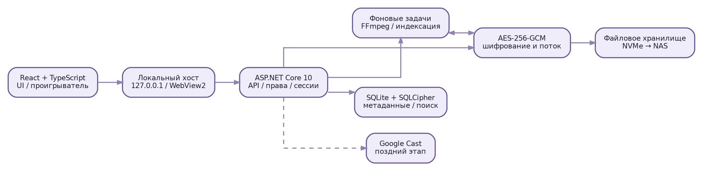

# Архитектура и установка

> Часть технической документации Shronchik v1.1. Полный документ: [Shronchik_Technical_Spec_v1.1.md](../Shronchik_Technical_Spec_v1.1.md).

# 3. Архитектура программного решения

## 3.1. Рекомендуемый технологический стек

| Слой | Выбор | Причина / ограничение |
|---|---|---|
| Интерфейс | React + TypeScript + Vite | Современный адаптивный интерфейс, повторное использование в будущей веб-версии |
| Десктоп-оболочка | Локальный хост + WebView2 | Окно Windows без обязательного браузера, веб-технологии внутри |
| Сервер | C# / ASP.NET Core на .NET 10 LTS | Потоковые ответы, фоновая обработка, права доступа, Windows |
| Локальная БД | SQLite; SQLCipher как вариант шифрования БД | Индексы, FTS, транзакции; проверить сборку и лицензию |
| Обработка медиа | FFmpeg/ffprobe как внешние компоненты | Определение метаданных, миниатюры, преобразование и превью |
| Потоковое шифрование | AES-256-GCM по независимым блокам | Можно дешифровать произвольную часть большого видео |
| Поиск | Индексы + SQLite FTS5 в зашифрованной базе | Быстрый поиск по названиям, тегам, описаниям |
| Очереди | Локальная устойчивая очередь jobs в БД | Перезапуск обработки после сбоя |
| Распространение | Локальный установщик Windows; GitHub позднее | Релизы без пользовательских медиа в репозитории |

[ПРОЕКТНОЕ РЕШЕНИЕ] Для первого выпуска интерфейс открыт в отдельном окне WebView2, а сервер слушает только локальный интерфейс `127.0.0.1` с динамическим портом. Для отладки разрешён системный браузер. WebView2 сам по себе не означает, что приложение доступно по сети.

Позднее при желании хостить сайт можно перенести сервер в серверную среду, использовать HTTPS и отдельную систему управления доступом. Это **новый режим развёртывания**, не просто изменение адреса `127.0.0.1` на `0.0.0.0`.



## 3.2. Разделение модулей

- `UI` — маршруты, карточки, страницы, модальные окна, анимации, языки, настройки, виртуальная сетка.
- `Auth` — два аккаунта, Argon2id, сессии, AFK, повторная аутентификация, файл восстановления.
- `Library` — категории, теги, альбомы, рейтинг, избранное, история, корзина.
- `Catalog` — импорт, дедупликация, метаданные, индексация, поиск, сортировки.
- `Media` — постеры, GIF-превью, видео и потоковая выдача с перемоткой.
- `Crypto` — ключи, шифрование блоков, контроль целостности, миграция ключей.
- `Recommendations` — случайная и рейтинговая выборки, частотность тегов.
- `Storage` — локальные тома, NAS-путь, перенос, атомарные операции, резервирование.
- `Settings` — проверка диапазонов, общие значения, цветовая схема, горячие клавиши.
- `Cast` — отдельный необязательный модуль; отключён до проверки на телевизоре.

Запрещено делать прямой доступ UI к файлам диска, ключам или SQLite. UI работает только через авторизованный API.

## 3.3. Запуск и остановка

1. Пользователь нажимает ярлык `Shronchik`.
2. Launcher проверяет наличие настроенного каталога, доступность диска, целостность конфигурации и состояние единственного экземпляра.
3. Сервис запускает локальный сервер, открывает БД, проверяет схему и запускает очередь незавершённых задач.
4. Открывается окно WebView2 со страницей выбора/ввода логина и пароля.
5. После авторизации отображается главная с тремя категориями.
6. При закрытии UI сервер останавливает новые задания, завершает транзакции, очищает временные ключи и выпускает lock-файл.

Обработка видеопревью может завершаться асинхронно, но потеря электропитания не должна оставлять «готовый» объект без полностью записанного зашифрованного оригинала.

## 3.4. Локальная безопасность API

- Привязка только к loopback, контроль `Host`, `Origin`, CSRF для изменяющих запросов.
- Сессионная cookie `HttpOnly`, `SameSite=Strict`, `Secure` при HTTPS; при локальном HTTP применять локальную схему с той же защитой от сторонних origin; не хранить токен в `localStorage`.
- Права проверяются на каждой операции. Никаких путей произвольных файлов от клиента.
- Изображения и видео выдаются лишь по непрогнозируемому идентификатору медиа и авторизованному запросу; отсутствует публичная папка оригиналов.
- Не разрешать CORS `*` для приватных ресурсов. Чёткая политика localhost/кастинга.
- Блокировка сессии должна реально перекрывать API медиаконтента, а не только показывать экран поверх видео.

# 4. Схема установки и расположение данных

## 4.1. Логика директорий

Приложение и данные хранятся независимо. Пример (пути не обязательные):

```text
C:\Program Files\Shronchik\
  Shronchik.exe
  server\
  web\
  ffmpeg\

D:\ShronchikLibrary\
  library.json            # версия/ID тома, без секретов
  vault\ab\cd\<opaque-id>.srm  # шифрованные оригиналы
  thumbs\...             # шифрованные обложки
  previews\...           # шифрованные анимированные превью
  db\catalog.sqlite      # БД: локально; защитить SQLCipher
  trash\...              # шифрованные файлы в корзине
  recovery-metadata\...  # служебные версии / незавершённые операции
```

**Важно:** имена оригинальных файлов (`video_name.mp4`) в файловых путях не оставлять: хранить нейтральные идентификаторы. Оригинальное имя — метаданные в защищённой БД. Файл восстановления ключей **не хранить рядом с медиатекой**.

## 4.2. Переустановка Windows

После переустановки Windows пользователь устанавливает Shronchik на C:, выбирает «Подключить существующую библиотеку», указывает `D:\ShronchikLibrary` и проходит проверку ключей и версии схемы. Система восстанавливает категории, теги, альбомы, рейтинг, настройки и корзину, если они сохранены вместе с защищёнными данными и ключ восстановления имеется. Нельзя полагаться только на Windows DPAPI без переносимого пути восстановления: после переустановки Windows эти секреты могут стать недоступны.

## 4.3. NAS / RAID

[СОГЛАСОВАНО] Пользователь планирует перенести библиотеку на NAS, вероятно с RAID. RAID повышает устойчивость к отказу отдельных дисков при правильной конфигурации, **но не защищает** от удаления, вируса, шифровальщика, ошибки приложения, повреждения БД или потери ключа. Резервная копия нужна отдельно.

[ПРОЕКТНОЕ РЕШЕНИЕ] На NAS размещать зашифрованные `vault`, `thumbs`, `previews`, `trash`, а активную БД SQLite с WAL оставлять на локальном SSD (с регулярными консистентными зашифрованными резервными копиями на NAS). Документация SQLite прямо указывает, что WAL не работает поверх сетевой файловой системы между разными машинами. Если в будущем нужен **именно удалённый каталог БД**, надёжный путь — перенести сервер и БД на одну машину NAS/сервер, а не открывать SQLite через SMB с другого ПК.

## 4.4. Алгоритм смены диска/директории

1. Проверить свободное место, доступ, права на запись и версию формата.
2. Приостановить импорт и фоновое построение превью.
3. Создать журнал миграции с перечнем файлов, размером и контрольными суммами шифротекста.
4. Копировать, не удаляя исходное; возобновлять после обрыва.
5. Проверить контрольные суммы, количество объектов и доступность выбранных образцов.
6. Атомарно изменить запись активного тома после полной проверки.
7. Предложить удалить старую копию **только после явного подтверждения** и при наличии резервной копии.

Простое изменение буквы диска должно решаться через выбор каталога и сопоставление стабильного UUID библиотеки; полные пути не должны быть разбросаны по тысячам строк БД.

