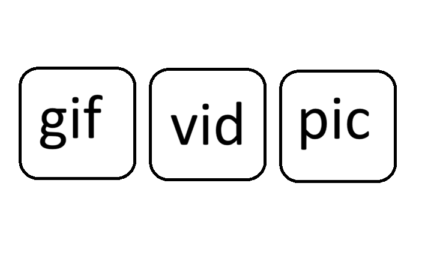
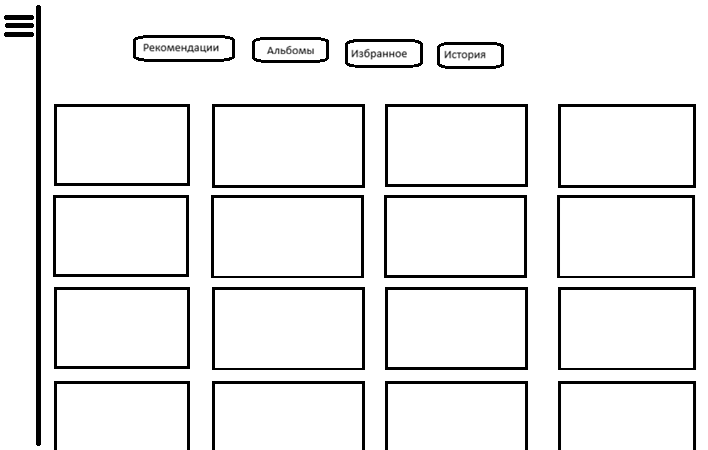
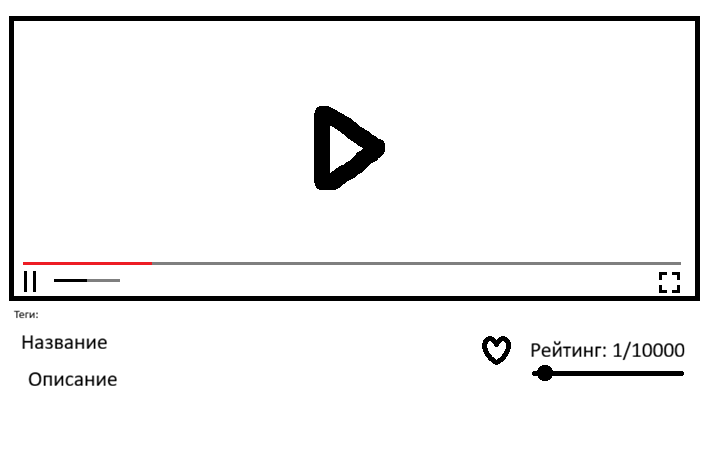

# Дизайн, настройки, клавиши

> Часть технической документации Shronchik v1.1. Полный документ: [Shronchik_Technical_Spec_v1.1.md](../Shronchik_Technical_Spec_v1.1.md).

# 13. Дизайн и карта экранов

## 13.1. Стиль проекта

Дизайн вдохновлён удобством видеогалерей уровня YouTube, **но не должен быть его точной копией**. Общий характер: тёмно-серые поверхности, мягкие фиолетовые акценты, аккуратные тени, много микроанимаций, ровная сетка, понятная типографика. Цвета нельзя жёстко зашивать в компоненты: все ключевые токены и скорость переходов управляются настройками. Указанные ниже значения — стартовые проектные предложения, кроме 300 мс.

| Дизайн-токен | Предлагаемое начало | Назначение |
|---|---|---|
| `--color-bg` | `#111116` | Основной фон, настраивается |
| `--color-surface` | `#1A1A22` | Карточки/панели |
| `--color-elevated` | `#242330` | Выдвижные панели / оверлеи |
| `--color-accent` | `#B9A1EF` | Нежно-фиолетовый акцент |
| `--color-text` | `#F4F3F7` | Основной текст |
| `--color-muted` | `#A4A0AF` | Вспомогательная информация |
| `--radius-card` | `14px` | Скругление карточек |
| `--duration-base` | `300ms` | Согласованная стартовая скорость |
| `--shadow-hover` | Мягкая цветная тень | Наведение на плитки и карточки |

Тени не должны превращать белые/яркие превью в визуально грязные; при выборе новой темы автоматически проверять контраст подписи/фона, показывать предпросмотр. Настраиваемый цвет кнопки влияет на hover, focus и active с производными оттенками.

## 13.2. Главная страница

{width=13.0cm}

**Элементы:** три крупные горизонтально расположенные плитки GIF / Видео / Фото; иконка шестерёнки настроек на главной странице; доступ к аккаунту/блокировке без перегрузки экрана. Карточки реагируют на наведение лёгким подъёмом, тенью и увеличением; две соседние слегка затемняются. На 21:9 композиция остаётся центрированной с разумной максимальной шириной, на узких экранах плитки могут переходить на две строки/столбец.

**Поведение:** клик открывает категорию и сохраняет активную роль. Все быстрые анимации не должны блокировать навигацию; можно нажать на плитку во время анимации. Настройки открываются отдельной страницей/модальным экраном и доступны обеим ролям в рамках прав.

## 13.3. Галерея внутри категории

{width=13.0cm}

**Сверху:** закреплённая панель вкладок: для Видео — `Рекомендации / Альбомы / Избранное / История`, для Фото и GIF — `Главная / Альбомы / Избранное / История`. Повторный клик «Рекомендации» в Видео создаёт новую подборку; «Главная» в Фото/GIF показывает случайно перемешанную ленту. **Слева:** кнопка-гамбургер раскрывает поиск и теги; нижняя кнопка-стрелка ведёт на главную. **Центр:** виртуализированная сетка со статичными постерами и подписями `название, рейтинг, просмотры` (для GIF/Фото без числа просмотров либо прочерк, поскольку счётчик формально задан только для видео). **Прокрутка:** бесконечная с курсорной подгрузкой.

Сетка должна поддерживать, например, **10 или 15 карточек в строке**, как указал пользователь; интерфейс пересчитывает ширину плитки по доступному месту. Если 15 на узком мониторе приводят к нечитаемым подписям, не скрывать проблему: ограничить отображаемый текст и предложить уменьшить количество. Плотность и размер текста — дополнительные настройки.

Рекомендуемый расчёт: `cardWidth = (contentWidth - gap*(columns-1)) / columns`; `columns` берётся из настроек и ограничивается пригодностью к текущей ширине, не ломая прокрутку и адаптивность. При очень маленьких карточках фиксировать aspect-ratio превью и обрезать только визуальную часть, не сам файл.

## 13.4. Страница просмотра видео

{width=13.0cm}

1. Крупный видеоплеер занимает основную доступную ширину.
2. При входе — слегка размытая обложка с Play, воспроизведение не начинается само.
3. Поверх нижней кромки — стандартные элементы Play, timeline, громкость, fullscreen; позже кнопка Cast.
4. Под плеером — кликабельные теги, затем название и необязательное описание.
5. В правой части строки метаданных — сердце и рейтинг `1/10000…10000/10000` с ползунком/полем числа.
6. Следующая секция — рекомендуемые карточки, по умолчанию 3 похожих + 2 случайных; счёт и доля настраиваемые.
7. Вся страница вертикально прокручивается; проигрыватель не обязан уменьшаться в «мини-плеер» при прокрутке (такого требования нет).

**Фокус и ввод:** при открытом плеере Space/стрелки контролируют видео, если курсор не находится в числовом поле рейтинга, описании или поле поиска. Изменение рейтинга не должно вызывать перемотку по стрелкам.

## 13.5. Другие обязательные экраны

| Экран | Обязательные элементы и переходы |
|---|---|
| Авторизация | Два фиксированных аккаунта, поле пароля, ошибка входа, предупреждение о слабом пароле, выбор языка при необходимости |
| Настройки / Общие | Язык, тема, скорость анимаций, AFK, сетка, сброс и предпросмотр |
| Настройки / Горячие клавиши | Список действий, захват комбинации, конфликт, отдельный сброс |
| Настройки / Рекомендации | Порог, 70/30, число похожих/случайных, параметры ленты |
| Настройки / Хранилище (Admin) | Активные пути, свободное место, проверка, перенос, обновление индексов |
| Настройки / Безопасность (Admin) | Изменение паролей, генерация/управление recovery-файлом, предупреждения |
| Импорт (Admin) | Один файл, редактор метаданных, выбор обложки, прогресс, отмена |
| Редактор медиа (Admin) | Название, описание, рейтинг, теги, подкатегория, альбомы, постер, удаление |
| Корзина (Admin) | Дата удаления, оставшиеся дни, восстановить/очистить навсегда |
| Альбом | Название, последняя обложка, количество, список файлов, управление содержимым |
| Просмотрщик фото/GIF | Масштаб, просмотр, возврат к выбранной позиции сетки |
| Блокировка | Экран пароля поверх состояния, без доступа к плееру; после входа вернуть тот же маршрут |
| Ошибка доступа | Отсутствующий том, неверный ключ, повреждение, отсутствие кодека, предложение конкретного решения |

## 13.6. Адаптивность и доступность

- Экраны проверки: 1920×1080, 2560×1080 (21:9), 3440×1440 (21:9), 3840×2160; допустить DPI scaling Windows 125–200%.
- Смена размера окна не сбрасывает просмотр/фильтры; интерфейс пересчитывает число карточек и высоту плеера.
- Клавиатурная навигация должна быть доступна для меню, карточек, поиска, настроек и модальных окон.
- Кнопки имеют понятные ARIA-label, focus-visible и независимые от цвета состояния.
- При настройке слишком быстрой анимации учитывать системное `prefers-reduced-motion` и отдельный выключатель анимаций.
- RU/EN через словари переводов и ICU-подобное форматирование чисел/дат; не вставлять английские строки прямо в компоненты.

## 13.7. Анимационные сценарии

| Триггер | Эффект | Время |
|---|---|---|
| Наведение на категорию | Тень/лёгкое увеличение, соседние плитки темнеют | Глобальное `animation_ms` |
| Раскрытие меню | Выезд панели и плавное изменение ширины сетки | Глобальное `animation_ms` |
| Переход категории | Fade + небольшая трансляция, skeleton до контента | Глобальное `animation_ms` |
| Hover на карточке видео | Задержка, плавная смена постера на loop-preview | Настраиваемая задержка |
| Подгрузка новых карточек | Неброское последовательное проявление без «скачка» сетки | Глобальное `animation_ms` |
| Вход в плеер | Fade-in постера и контролов | Глобальное `animation_ms` |
| Приостановка/конец | Контролы скрываются/появляются плавно | Глобальное `animation_ms` |
| Запирание экрана | Плавная непрозрачная блокировка и остановка потока | Ускоренный безопасный переход |

Анимации должны использовать CSS transform/opacity вместо тяжёлых layout-пересчётов там, где это возможно. Производительность измеряется при 10 и 15 карточках в строке на целевом железе.

# 14. Настройки и их схема

## 14.1. Общие правила

Все ключи настроек строго типизированы, имеют допустимые диапазоны и версию схемы. UI показывает текущее значение, краткое описание, кнопку «Вернуть стандартное» для поля и «Сбросить раздел» для группы; общий сброс требует подтверждения. Сброс интерфейса **не удаляет библиотеку, пароли, ключи, теги или медиа**. Для операций безопасности предусмотрен отдельный административный диалог, не вызываемый общим сбросом.

Значения ниже, кроме специально согласованных, — **предлагаемые начальные значения**, необходимые для разработки и будущей проверки.

## 14.2. Внешний вид

| Ключ | Значение по умолчанию | Диапазон/поведение | Доступ |
|---|---|---|---|
| `ui.language` | `ru` | `ru`, `en` | Оба |
| `ui.theme` | `custom_dark` | пользовательская/пресеты | Оба |
| `ui.backgroundColor` | `#111116` | RGB/HEX + пикер | Оба |
| `ui.surfaceColor` | `#1A1A22` | RGB/HEX + пикер | Оба |
| `ui.accentColor` | `#B9A1EF` | RGB/HEX + пикер | Оба |
| `ui.textColor` | `#F4F3F7` | RGB/HEX + пикер | Оба |
| `ui.mutedTextColor` | `#A4A0AF` | RGB/HEX + пикер | Оба |
| `ui.shadowStrength` | `0.35` | `0–1` | Оба |
| `ui.hoverNeighborDim` | `0.18` | `0–0.6` | Оба |
| `ui.cardRadiusPx` | `14` | `0–30` | Оба |
| `ui.animationMs` | **300** | `0–1000` мс | Оба |
| `ui.reduceMotion` | `auto` | `auto/on/off` | Оба |
| `ui.gridColumns` | `10` | `2–20`, с адаптивным пределом | Оба |
| `ui.gridGapPx` | `12` | `2–32` | Оба |
| `ui.cardAspectRatio` | `16:9` | `16:9 / 4:3 / 1:1` | Оба |
| `ui.cardTitleLines` | `2` | `1–3` | Оба |
| `ui.sidebarExpanded` | `false` | Сохраняется | Оба |
| `ui.showSkeletons` | `true` | Да/нет | Оба |
| `ui.fontScale` | `1.0` | `0.8–1.4` | Оба |

## 14.3. Воспроизведение и превью

| Ключ | Значение | Диапазон/поведение | Доступ |
|---|---|---|---|
| `player.autoplayOnOpen` | **false** | Не изменять базовое правило без отдельного согласования | Оба: чтение |
| `player.startFromBeginning` | **true** | Всегда с начала | Оба: чтение |
| `player.volume` | `0.7` | `0–1`, сохраняется | Оба |
| `player.seekSeconds` | **5** | Предлагаемо `1–30` сек | Оба |
| `player.resumeAfterFullscreenExit` | **true** | Согласовано | Оба: чтение |
| `player.previewMuted` | **true** | Обязательно в hover | Оба: чтение |
| `player.hoverDelayMs` | `300` | `0–1200` мс | Оба |
| `player.thumbnailCandidates` | `5` | `3–12` кадров при импорте | Admin |
| `player.gifVisibilityMarginPx` | `80` | `0–300` | Оба |
| `player.maxAnimatedCards` | `12` | `1–40` после тестов | Оба |
| `player.gpuDecodePreference` | `auto` | `auto/on/off` | Оба |
| `player.ramCacheMB` | `512` | `128–4096` (предложение) | Оба |
| `player.showEndPoster` | **true** | Согласовано | Оба: чтение |
| `player.showRelatedBelow` | **true** | Согласовано | Оба |

## 14.4. Рекомендации и поиск

| Ключ | Значение | Диапазон/поведение | Доступ |
|---|---|---|---|
| `feed.ratedPercent` | **70** | `0–100`%; остальное случайное | Оба |
| `feed.randomPercent` | **30** | Производное `100 - ratedPercent` | Оба |
| `feed.minimumRating` | `7000` | `1–10000`, пока предварительное значение | Оба |
| `feed.historyDepth` | **30** | Согласовано для User | Оба: чтение |
| `feed.ratingWeight` | **0.6** | `0–1`, согласованный вес рейтинга | Оба |
| `feed.tagWeight` | **0.4** | Производное `1 - ratingWeight`, согласовано | Оба |
| `feed.relatedCount` | **3** | `0–30` | Оба |
| `feed.randomRelatedCount` | **2** | `0–30` | Оба |
| `feed.refreshOnTabClick` | **true** | Согласовано | Оба: чтение |
| `search.requiredTagMode` | `AND` | Базовое правило | Оба |
| `search.queryDebounceMs` | `200` | `0–600` | Оба |
| `search.pageBatchSize` | `60` | `20–150` | Оба |
| `history.maxVisibleItems` | **10** | На корневую категорию | Оба: чтение |

## 14.5. Безопасность, хранение, фоновые задачи

| Ключ | Значение | Диапазон/поведение | Доступ |
|---|---|---|---|
| `security.afkMinutes` | **5** | `1–120` минут | Оба |
| `security.afkWhilePlaying` | **false** | Воспроизведение отменяет AFK | Оба: чтение |
| `security.pauseWhenLocked` | **true** | Согласуется с остановкой потока | Оба: чтение |
| `security.lockOnManualCommand` | `true` | Действие меню | Оба |
| `security.passwordWarning` | `true` | Пока пароль `1111` | Оба: чтение |
| `storage.mediaRoot` | Выбор при первичной установке | Меняет Admin | Admin |
| `storage.databaseRoot` | Локальный SSD | Меняет Admin; NAS-ограничения | Admin |
| `storage.trashDays` | **30** | Admin меняет срок; предлагаемый диапазон 1–365 дней | Admin |
| `storage.verifyOnStartup` | `quick` | `quick / full` | Admin |
| `storage.thumbnailVariantSizes` | `small/medium/large` | Рабочие профили | Admin |
| `storage.backupReminderDays` | `7` | `0–90` | Admin |
| `jobs.maxThumbWorkers` | `2` | `1–8`, подобрать по железу | Admin |
| `jobs.maxTranscodes` | `1` | `1–3` после тестов | Admin |
| `jobs.pauseOnBattery` | `false` | Для ПК не требуется | Admin |
| `cast.enabled` | `false` до интеграции | Поздний этап | Оба |

**Важно:** целевые настройки носят общий характер, как пожелал пользователь. Нельзя silently делать отдельные `User.settings` и `Admin.settings`. Административные поля меняет только Admin, но эстетические параметры, AFK, клавиши и рекомендации доступны обеим ролям с немедленной общей синхронизацией.

## 14.6. Формат конфигурации

Пример логической схемы (секреты сюда **не входят**):

```json
{
  "schemaVersion": 1,
  "ui": {
    "language": "ru",
    "theme": "custom_dark",
    "backgroundColor": "#111116",
    "accentColor": "#B9A1EF",
    "animationMs": 300,
    "gridColumns": 10
  },
  "security": { "afkMinutes": 5 },
  "feed": {
    "ratedPercent": 70,
    "minimumRating": 7000,
    "historyDepth": 30,
    "relatedCount": 3,
    "randomRelatedCount": 2
  },
  "storage": { "libraryVolumeId": "<volume-id>" }
}
```

В настоящей реализации эти значения проходят JSON Schema/серверную валидацию; конфигурация не содержит мастер-ключ, пароли, recovery-secret или приватные абсолютные пути, если сохранённый файл может попасть в публичный репозиторий.

# 15. Горячие клавиши

Горячие клавиши редактируются в отдельной вкладке настроек. При назначении приложение показывает захваченную комбинацию и её область (`Плеер`, `Галерея`, `Глобально`), проверяет пересечение и предлагает заменить/отменить. Есть «Сбросить эту клавишу» и «Сбросить все». Системные сочетания Windows не перехватывать.

| Действие | Начальное сочетание | Контекст |
|---|---|---|
| Пауза / продолжить | `Space` | Плеер |
| Назад 5 секунд | `←` | Плеер |
| Вперёд 5 секунд | `→` | Плеер |
| Громче | `↑` | Плеер |
| Тише | `↓` | Плеер |
| Полный экран | `F` | Плеер |
| Выйти из полного экрана | `Esc` | Плеер |
| Выключить / включить звук | `M` | Плеер |
| Открыть/закрыть поиск и теги | `Ctrl+F` | Галерея; отменить стандартный поиск браузера в активном окне |
| Перейти на главную | `Alt+Home` | Не во время ввода текста |
| Заблокировать Shronchik | `Ctrl+Shift+L` | Глобально в окне приложения |
| Следующий/предыдущий файл | `Alt+→ / Alt+←` | Фото и GIF просмотрщик |

Клавиши кроме перечисленных владельцем — предварительные предложения. При фокусе на input/textarea/числовом рейтинге текстовый ввод имеет приоритет. Не перехватывать `Esc` для закрытия вкладки, если открыт fullscreen. В проигрывателе `Space` останавливает прокрутку страницы и ставит видео на паузу; в поле описания вводится обычный пробел.

